# Portos: galeria atual

Imagens renderizadas dos tiles e sprites utilizados na ROM. Exibem os atores permanentes do transporte; NPCs condicionados pela história não são simulados.

## Pallet

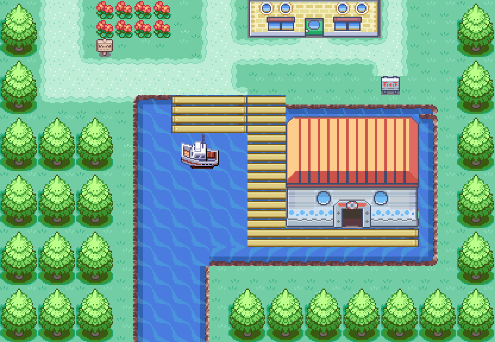

## Fuchsia / Route 19

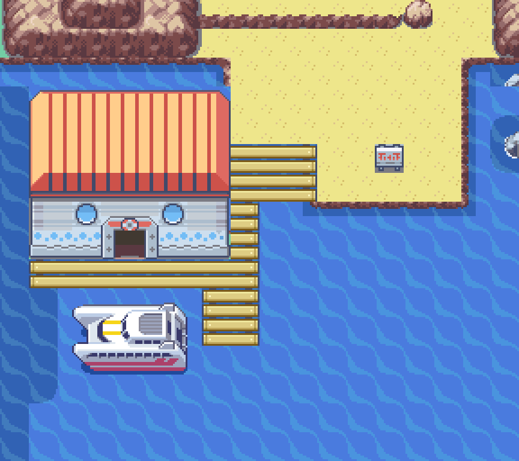

[Interior com navio e detalhes](porto-fuchsia.md).

## Vermilion

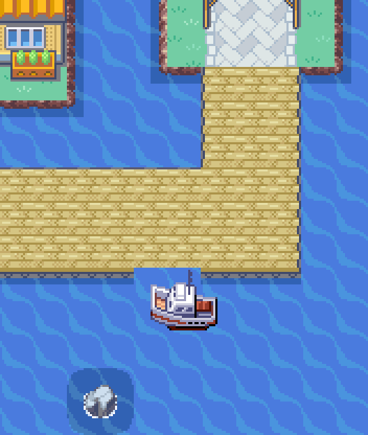

## Mossdeep - ilha oeste

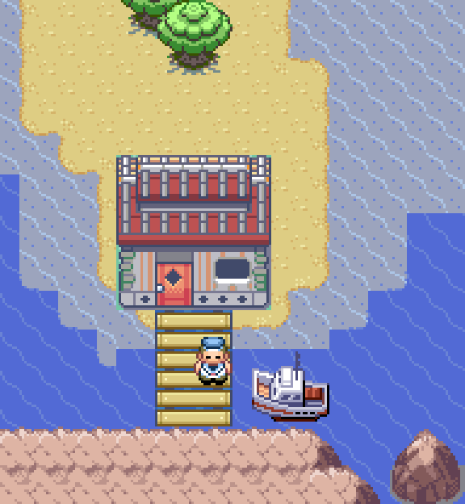

## Cinnabar

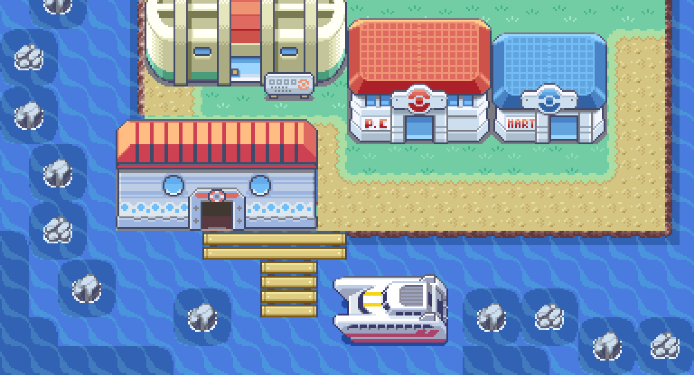

## Route 25

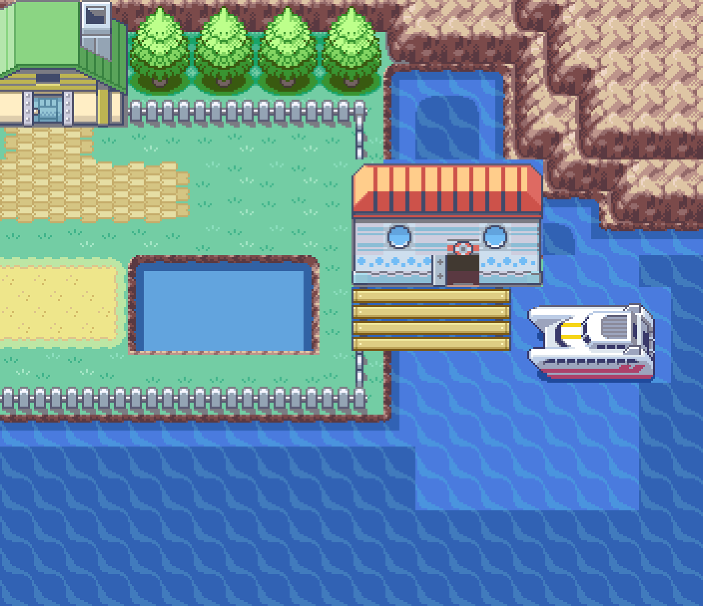

## Lavender

O [terminal atual](porto-lavender.md) substitui a casa do estaleiro, com o
mesmo prédio de Pallet e atendimento da rede geral dentro do porto.

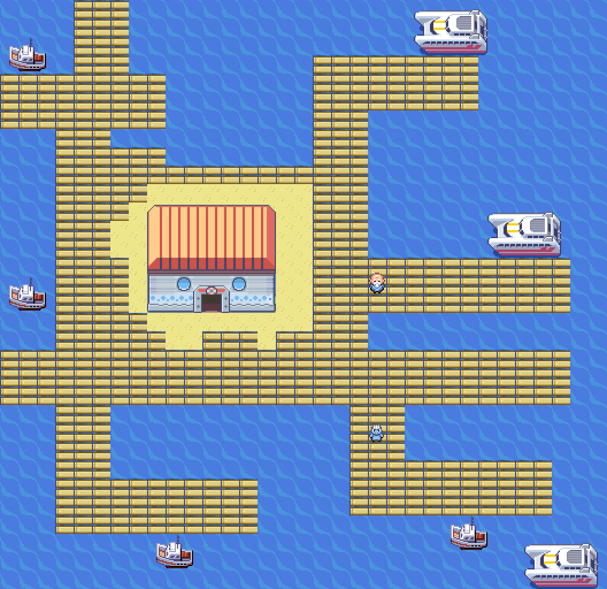

## Sootopolis

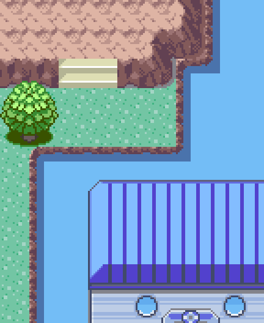

## Dewford

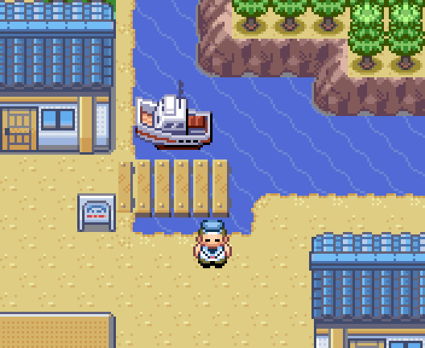

## Petalburg coast

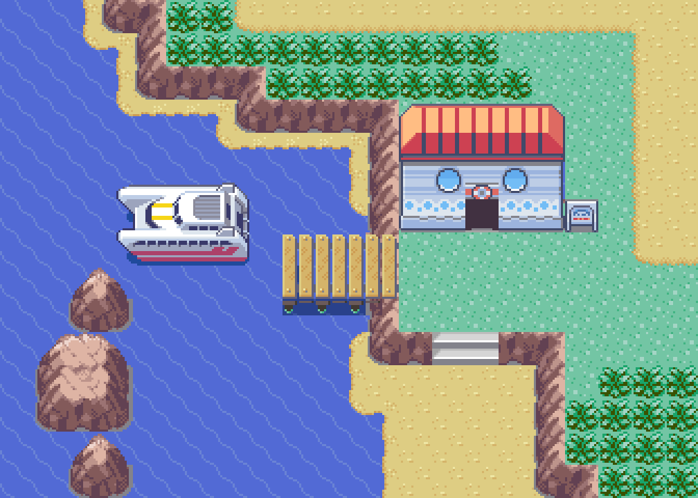

## Pacifidlog

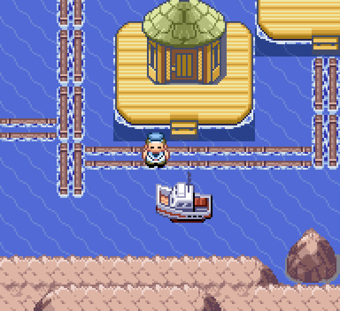

## Battle Frontier

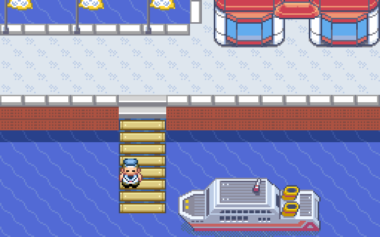

## Slateport

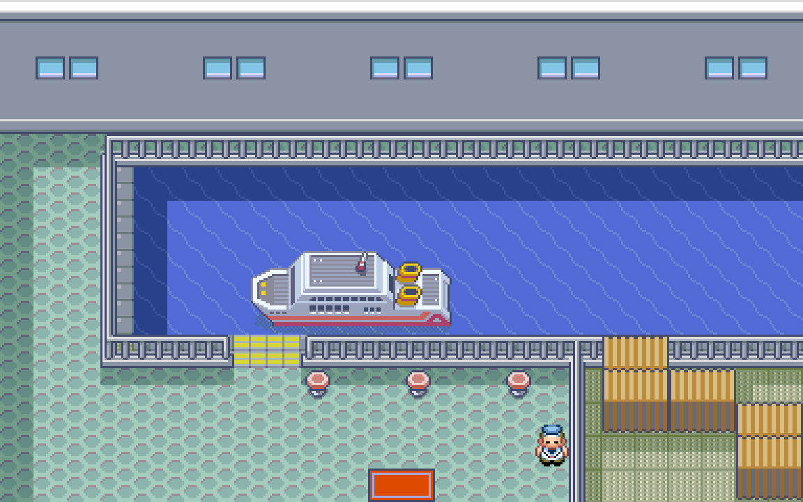

## Lilycove

## One Island

## Two Island

## Three Island

## Four Island

## Five Island

## Six Island

## Seven Island

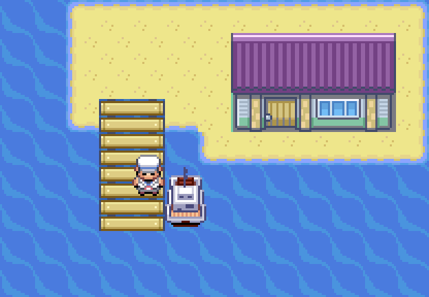

## Sala do Rotom

Mantida com o visual nativo da Torre de Lavender.

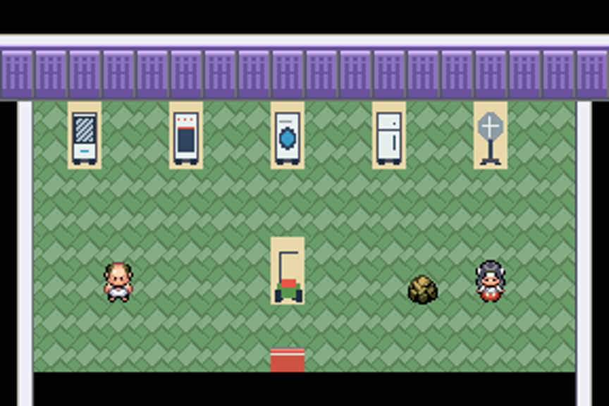
