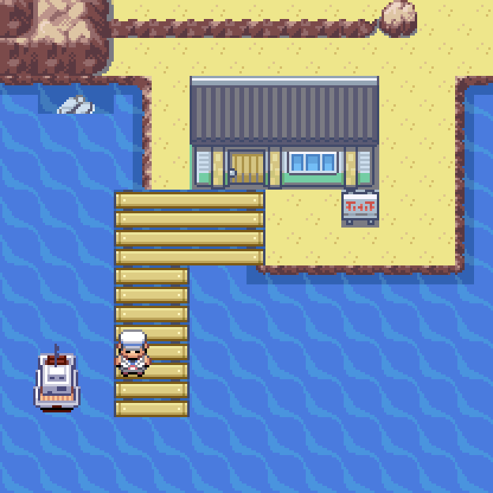
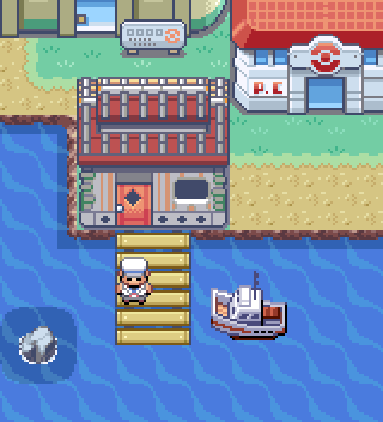
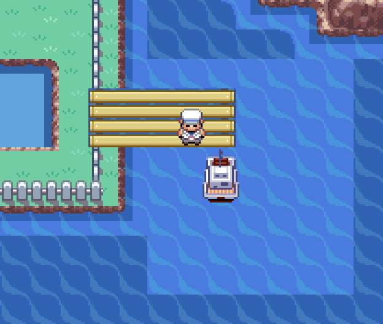
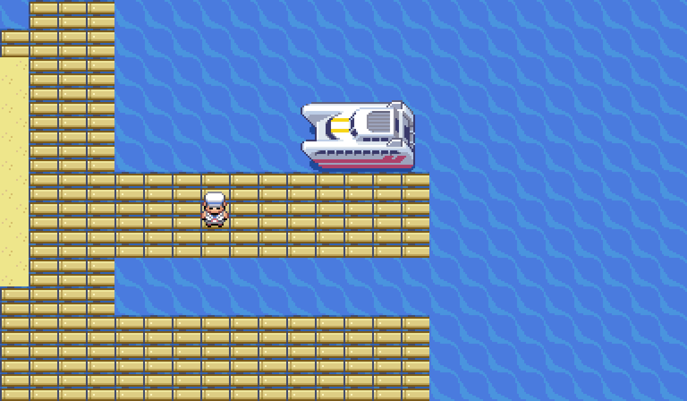
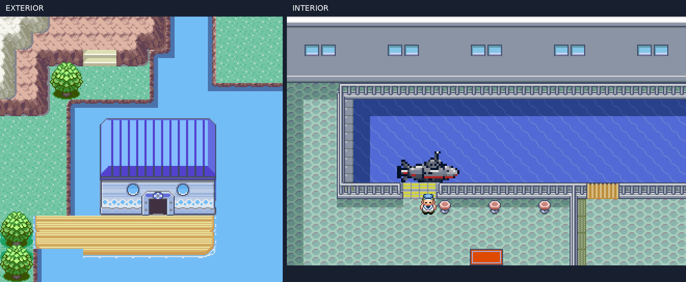
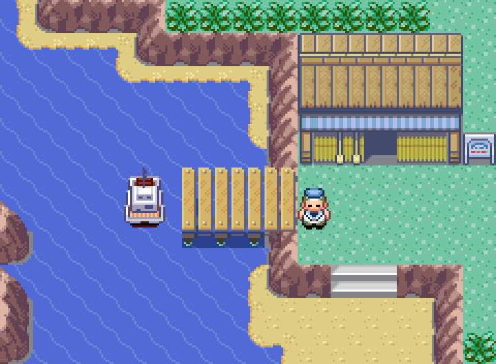

# Portos: galeria atual

Imagens renderizadas dos tiles e sprites utilizados na ROM. Exibem os atores permanentes do transporte; NPCs condicionados pela história não são simulados.

## Pallet

## Fuchsia / Route 19

## Vermilion

## Mossdeep - ilha oeste

## Cinnabar

## Route 25

## Lavender

## Sootopolis

[Detalhes e capturas no emulador](porto-sootopolis.md).

## Dewford

## Petalburg coast

## Pacifidlog

## Battle Frontier

## Slateport

## Lilycove

## One Island

## Two Island

## Three Island

## Four Island

## Five Island

## Six Island

## Seven Island

## Sala do Rotom

Mantida com o visual nativo da Torre de Lavender.

