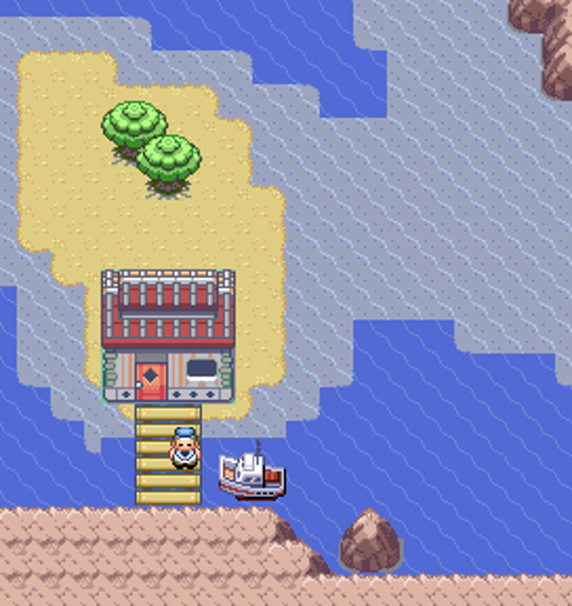
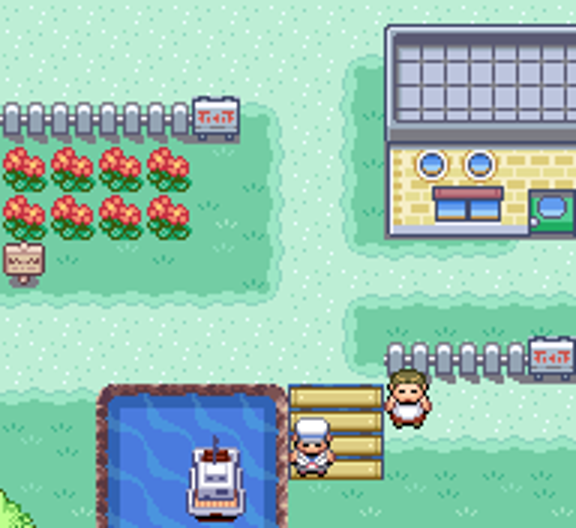
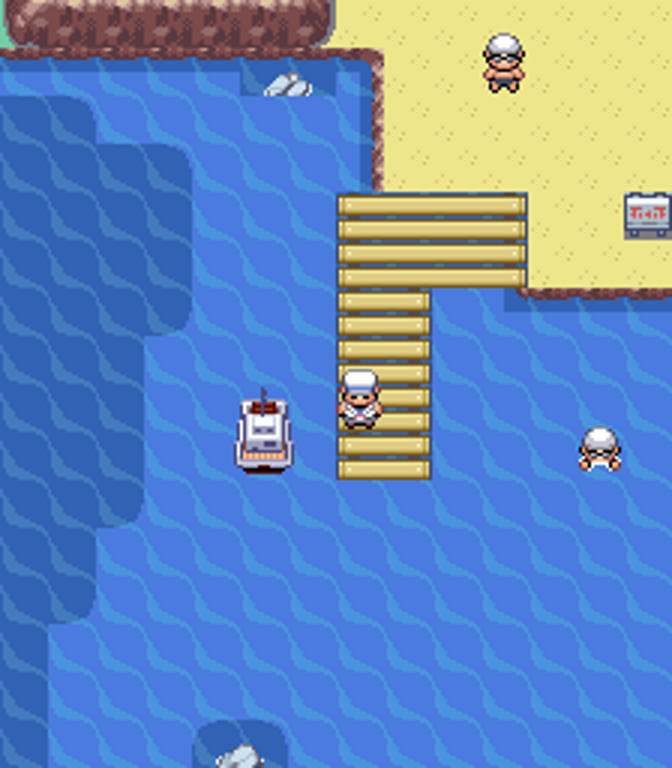
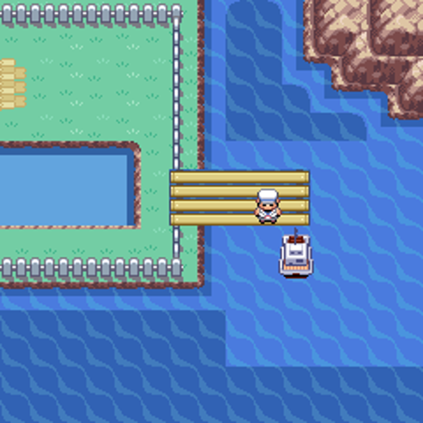
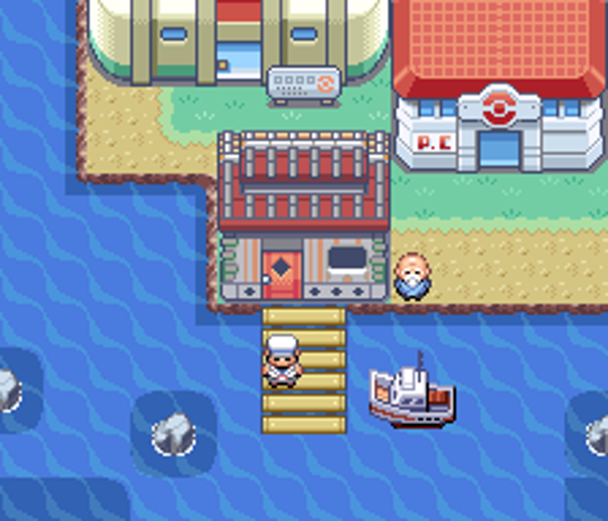
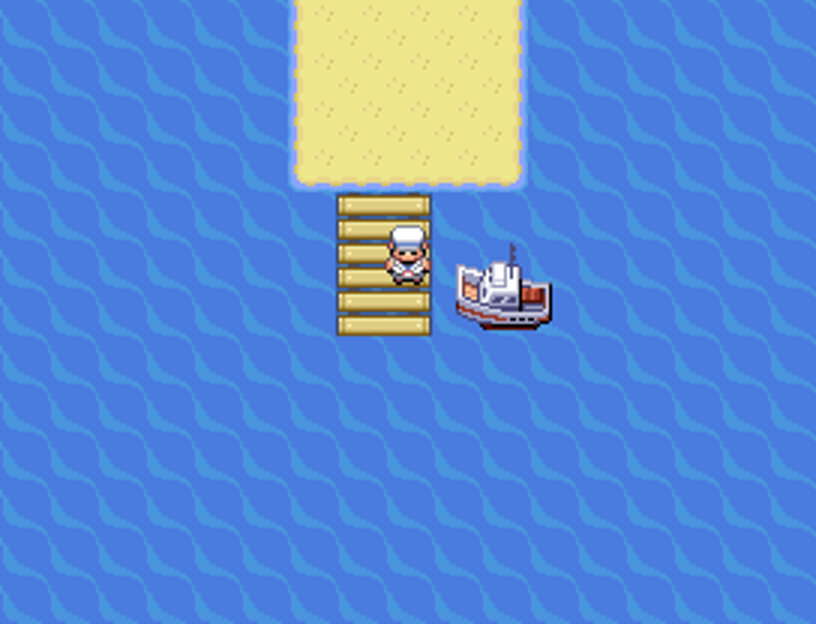
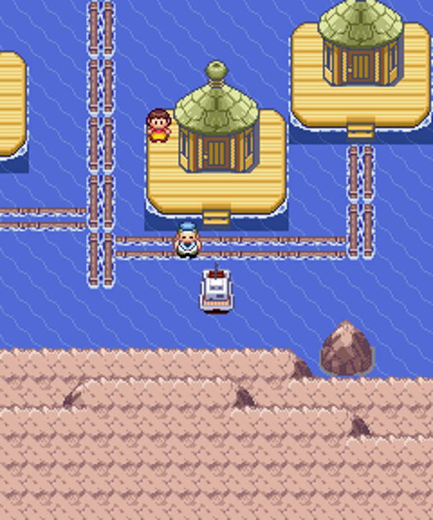
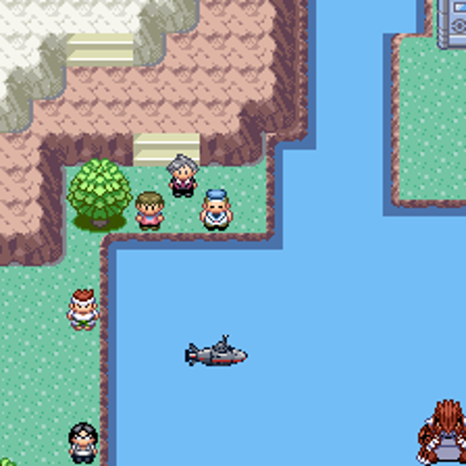
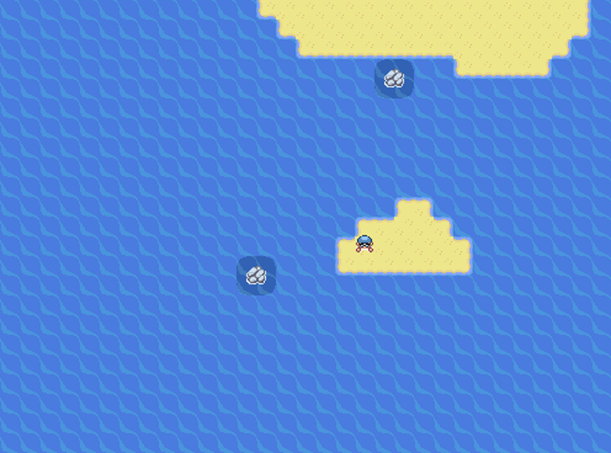
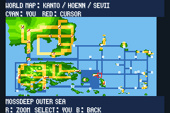

# Atualização costeira — portos, mapas e níveis

As imagens de composição abaixo são renderizadas dos arquivos reais de mapa e dos tiles usados para compilar a ROM. As imagens com “no emulador” são capturas de mGBA da versão entregue. A cena completa da campanha determina quais personagens de história ficam visíveis.

## Portos

- Mossdeep: casa no estilo da cidade na ilha oeste, uma posição abaixo, areia em volta, ponte vertical e barco ao lado. A ponte alcança a água azul. A costa da cidade principal foi preservada.
- Pallet: pequena ponte e barco, sem casa adicional.
- Rota 19: porto na parte oeste da praia, longe da placa; ponte pequena e barco.
- Rota 25: ponte mais a leste da casa de Bill; a água local continua bloqueada para Surf.
- Cinnabar: terreno nativo restaurado, casa de barqueiro sobre terra, ponte e barco; saídas de prédios existentes preservadas.
- Sevii: as sete ilhas usam uma pequena ponte de 2×3 tiles, praia com bordas completas, um barco e um capitão. Não há espaço nessa área de transição para outra casa sem ampliar o terreno.
- Pacifidlog: plataformas e passarelas nativas preservadas, barco encostado no caminho existente.
- Sootopolis: submarino de 32×32 pixels, colisão em até seis tiles, duas linhas de água livres entre ele e o barqueiro.
- Slateport: serviço mundial apenas dentro do porto; Briney mantém seu trajeto local de história.

### Mossdeep — ilha oeste

### Pallet

### Rota 19

### Rota 25

### Cinnabar

### Portos de Sevii

### Pacifidlog

### Submarino de Sootopolis

### Ilhotas com areia

## Rotom e Spiritomb

A sala do Rotom conserva os pontos de interação da TV e dos cinco eletrodomésticos. A referência de ambiente é Old Chateau/Platinum, com piso, paredes e paleta da Torre de Lavender no próprio jogo. O poço de Spiritomb, em Memorial Pillar, foi mantido.

## Rivais, níveis e mapa

Eren e Luffy passam a nascer a dois tiles do jogador e caminhar um tile até ele. A criação dos objetos aplicava o deslocamento interno duas vezes; a mesma convenção foi corrigida para as chegadas da introdução e os aliados Galactic.

Treinadores comuns dentro e fora dos ginásios usam a média atual −5/+2. Líderes usam −1/+5, com +5 obrigatório no principal. Quantidades continuam dependendo da ordem regional e do tamanho da equipe. Formas, evoluções e golpes são escolhidos usando o nível final, calculado uma única vez.

O mapa conserva a geometria aprovada e a projeção compartilhada nas conexões. Ao centralizar em você, mostra o nome real da rota atual, inclusive quando ela fica longe do centro esquemático. A tentativa de arredondar o marcador à linha azul foi descartada porque criava saltos em movimentos curtos.

## Validação desta versão

- 530 equipes de treinadores/líderes geradas em médias 5, 18, 20, 95 e 12; batalha dupla real de Mossdeep com principal no nível 23.
- 54 mapas marítimos integrados alcançáveis em uma rede de 161.686 tiles de água. conforme colisões compiladas; auditoria de grafo. não travessia humana de cada tile.
- 572 conexões com posições compartilhadas; saída curta de Mossdeep e avanço dentro da rota realizados com controles.
- Quinze áreas de porto: colisão do casco completo, um capitão de serviço mundial por local; entradas de casas e saída de Sevii verificadas com controles.
- Viagem Pallet → Rota 25 → Pallet realizada pelos menus dos capitães e animação nativa de barco.
- As quatro edições: 192 amostras de ginásio cada, EVs/IVs, golpes e formas legais; captura de Rotom na TV, seis mudanças de forma, poço de Spiritomb, fósseis e localizações da Pokédex.
- Onze novas camadas reproduzidas sobre a fonte independente da versão anterior; 1.444 arquivos finais comparados por hash.
- Verificação final das quatro ROMs, hashes e inicialização no navegador com mGBA.

A revisão e validação foram organizadas em até cinco rodadas direcionadas, incluindo as correções dos defeitos encontrados. Nenhum torneio foi repetido. Os testes antigos de PWT e mecânicas ficam associados à ROM do PR #79, preservada separadamente. Esta entrega não inclui uma campanha inteira jogada do início aos créditos.
