# Atualização costeira — portos, mapas e níveis

As imagens de composição abaixo são renderizadas dos arquivos reais de mapa e dos tiles usados para compilar a ROM. As imagens com “no emulador” são capturas de mGBA da versão entregue. A cena completa da campanha determina quais personagens de história ficam visíveis.

## Portos

[Galeria com os 21 portos e a sala do Rotom](PORTOS-GALERIA.md). As sete Sevii usam a mesma estrutura nativa; cada ilha possui sua própria casa com entrada e saída correspondentes.

- Mossdeep: casa no estilo da cidade na ilha oeste, areia em volta, ponte vertical e barco ao lado; preservado como aprovado.
- Pallet: a versão costeira descrita aqui usava uma casa na margem direita; o [terminal atual de Slateport em Pallet](porto-pallet.md) substitui essa casa. Ponte horizontal prolongada dois tiles para a esquerda sobre o mar; barco deslocado um tile para a direita na última revisão. Seu casco fica abaixo da madeira, inteiramente na água.
- Fuchsia / Rota 19: casa acima da parte da ponte em terra, ponte pequena e barco. Mantida como aprovada.
- Rota 25: ponte a leste de Bill; a água local permanece bloqueada para Surf.
- Cinnabar: terreno nativo preservado, casa de barqueiro, ponte e barco; sem alteração nesta revisão.
- Sevii: casa compacta nativa com um tile de borda de areia ao redor, cantos e bordas completos, ponte prolongada um tile até a praia, barco vertical aproximado um tile da ponte e um capitão por ilha.
- Dewford: barco horizontal junto à ponte nativa.
- Costa de Petalburg: barco vertical aproximado um tile da extremidade da ponte; objeto e percurso originais de Briney preservados separadamente.
- Pacifidlog: plataformas nativas preservadas, barco horizontal.
- Sootopolis: [terminal ligado à terra por ponte, capitão interno da rede geral e submarino ampliado](porto-sootopolis.md).
- Battle Frontier: pequena ponte vertical e um único S.S. Tidal ao lado, sem sobreposição de embarcações.
- Slateport e Lilycove: S.S. Tidal nativo dentro da água dos portos, com os cascos bloqueados para Surf. Um serviço mundial por porto; os atendentes dão orientação, sem menu duplicado.
- Vermilion: barco horizontal sobre o vão com água no trecho leste da ponte; passarela oeste e suas saídas preservadas.

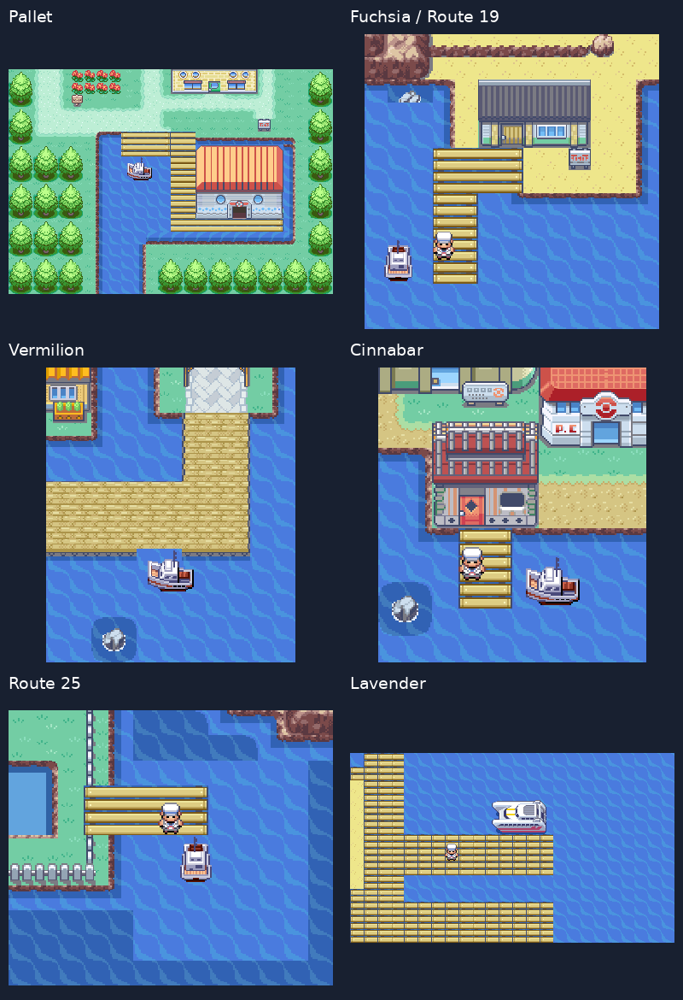

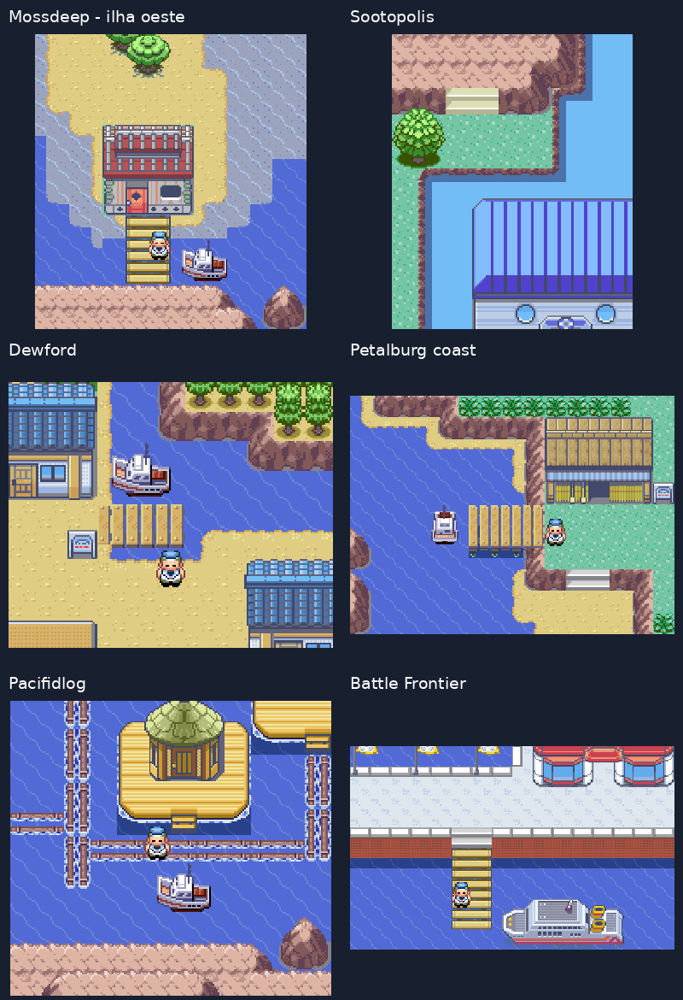

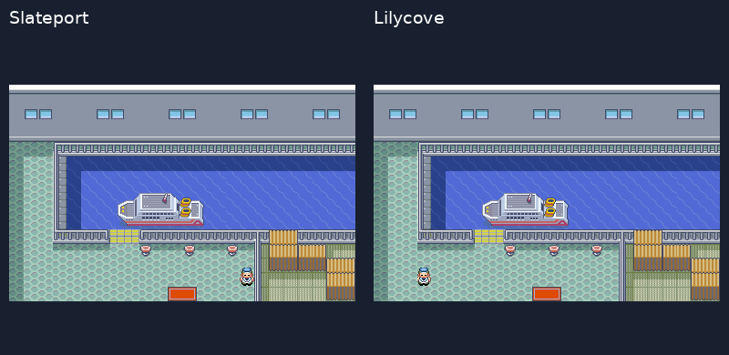

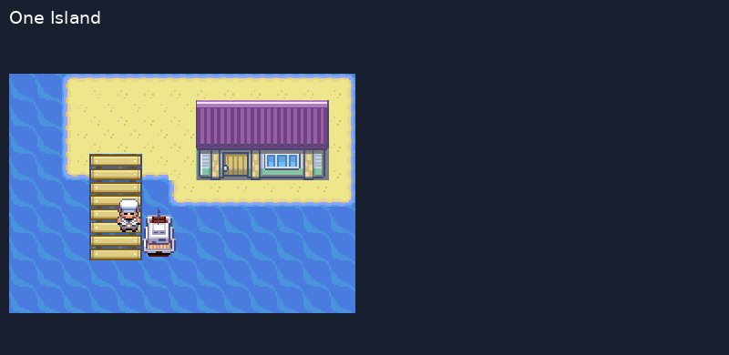

### Ilhotas com areia

As 57 áreas marítimas geradas foram auditadas: sem fragmentos de grama nas ilhotas e com pedras completas. Os cantos internos e as pontas estreitas das praias usam quadrantes dos tiles nativos; o terreno e as colisões não foram recortados para fechar o desenho. Também foram corrigidos cinco pedaços de pedra nas bordas editadas de mapas originais.

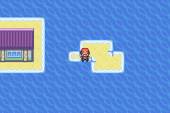

[Revisão visual dos mapas costeiros gerados](revisao-das-costas.md).

## Rotom e Spiritomb

A sala do Rotom conserva os pontos de interação da TV e dos cinco eletrodomésticos. A referência de ambiente é Old Chateau/Platinum, com piso, paredes e paleta da Torre de Lavender no próprio jogo. O poço de Spiritomb, em Memorial Pillar, foi mantido.

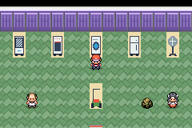

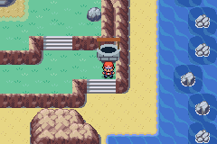

## Rivais, níveis e mapa

Eren e Luffy nascem inteiramente fora da câmera atual e caminham por um caminho livre até um tile do jogador. A busca considera a posição e o deslocamento da câmera; não depende da direção pela qual o jogador entrou. Evita água, pedras, paredes, ledges, warps e outros personagens. Se não houver um caminho vindo de fora da tela naquela posição, aguarda o jogador avançar: não usa aparição dentro da tela como alternativa. Foram observadas entradas válidas em dois pontos de cada uma das 12 rotas.

A sequência lateral agora mantém a orientação em todos os frames: a pose parada usa o perfil correto e os passos têm espelhamento consistente. A mesma correção vale para Eren/Luffy no PWT; os PNGs e as paletas originais foram preservados. Os 12 encontros têm introduções maiores e falas próprias após a batalha.

As animações abaixo foram gravadas no mGBA. A equipe, as flags e a posição inicial são preparadas para a demonstração; os sprites, a caminhada, os diálogos e a entrada na batalha são nativos, sem escrita nas coordenadas dos rivais.

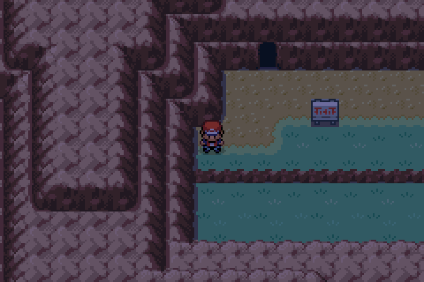

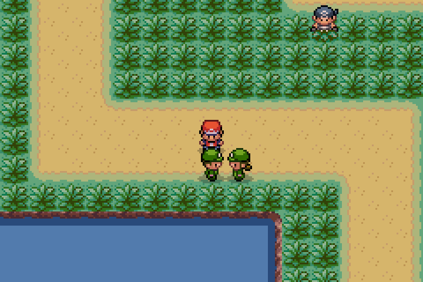

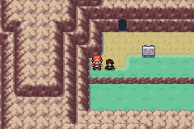

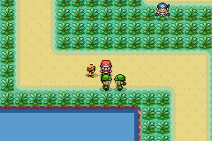

Treinadores comuns dentro e fora dos ginásios usam a média atual −5/+2. Líderes usam −1/+5, com +5 obrigatório no principal. Quantidades continuam dependendo da ordem regional e do tamanho da equipe. Formas, evoluções e golpes são escolhidos usando o nível final, calculado uma única vez.

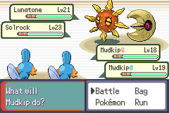

O desenho marítimo foi recalculado a partir das conexões reais entre os mapas: segmentos horizontais/verticais e contornos retangulares, preservando a arte de terra e cidades. O mapa é esquemático; distâncias físicas não têm escala uniforme. Menu, paredes dos Centros Pokémon e AREA da Pokédex compartilham o desenho. A projeção do jogador conserva posições compartilhadas nas conexões e acompanha o movimento dentro da rota, sem saltar para a linha azul mais próxima.

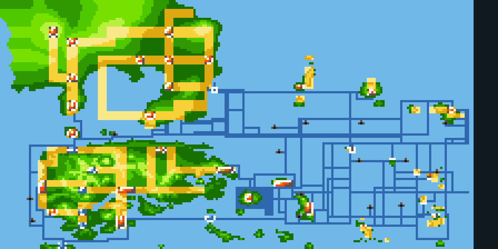

As rotas originais de Surf também estão desenhadas: Pallet → Rota 21 → Cinnabar; Fuchsia → Rota 19 → Rota 20/Seafoam → Cinnabar; costa de Petalburg → Rotas 105/106 → Dewford. O corredor oeste liga a Rota 114 e a costa de Rustboro ao canal de Dewford. Lavaridge permanece no interior.

Os ícones das 14 cavernas novas usam a projeção das coordenadas das portas verdadeiras, incluindo os acessos de Dive. Seafoam tem ponto próprio, compartilhado por seus cinco andares. Os marcadores da AREA acompanham essas correções; Porygon, os fósseis e as outras famílias especiais apontam para seus locais de obtenção, incluindo cassino, museu e workshop.

O zoom usa um atlas de 448×224 com detalhes das imagens regionais nativas, em vez de somente duplicar os pixels do mapa geral. Os corredores e ícones continuam nas mesmas coordenadas; menu, parede e Pokédex compartilham os mesmos dados.

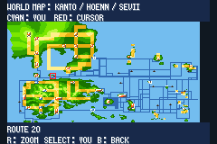

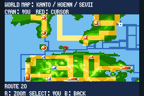

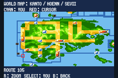

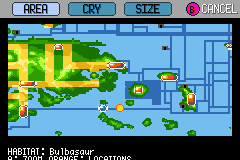

## Diglett’s Cave e Rock Tunnel

Diglett’s Cave liga a Rota 11, perto de Vermilion, à Rota 2. Ela agora tem três grunts Galactic explorando Kanto: dois enfrentam o jogador e um faz o levantamento do túnel. Os dois combates usam níveis comuns conforme a média atual da equipe e flags individuais que não completam batalhas do navio. A passagem e as saídas originais permanecem abertas.

O Rock Tunnel é outra caverna: continua iluminado sem Flash e conserva sua missão anterior com quatro grunts do Team Magma, dois por andar.

## Validação desta versão

- 530 equipes de treinadores/líderes geradas em médias 5, 18, 20, 95 e 12; batalha dupla real de Mossdeep com principal no nível 23.
- 54 mapas marítimos integrados alcançáveis em uma rede de mais de 160 mil tiles de água, conforme colisões compiladas; auditoria de grafo, não travessia humana de cada tile.
- 572 conexões com posições compartilhadas; saída curta de Mossdeep e avanço dentro da rota realizados com controles.
- Vinte e uma áreas de porto: colisão do casco completo, um capitão de serviço mundial por local; entradas e retornos das nove casas adicionais, acesso às pontes e saída de Sevii verificados com controles.
- Viagem Pallet → Rota 25 → Pallet realizada pelos menus dos capitães e animação nativa de barco.
- As quatro edições: 192 amostras de ginásio cada, EVs/IVs, golpes e formas legais; captura de Rotom na TV, seis mudanças de forma, poço de Spiritomb, fósseis e localizações da Pokédex.
- Vinte e três novas camadas reproduzidas sobre a fonte independente da versão anterior; 1.483 arquivos finais comparados por hash.
- Auditoria estrutural de 343 mapas editados, 57 áreas costeiras geradas e nove bancos de bordas de praia comparados com os bytes compilados. Isso não declara perfeição visual de todos os mapas.
- Entradas fora da câmera e transição nativa de batalha de Eren/Luffy gravadas nas Rotas 4/6; 24 posições verificadas nas 12 rotas, com caminhos livres. Orientação lateral conferida nas animações da campanha e do PWT. Dois grunts da Diglett’s Cave derrotados por controles, sem alterar flags do navio. As vitórias usam atributos do jogador aumentados apenas na memória para encurtar o teste, sem afirmar balanceamento.
- Doze ligações originais conferidas no desenho; quinze entradas de cavernas e os cinco andares de Seafoam conferidos pelo código nativo. As 1.025 espécies canônicas possuem localizações disponíveis na AREA; pixels do zoom de menu/Pokédex e retorno das telas verificados.
- Verificação final das quatro ROMs, hashes e inicialização no navegador com mGBA.

A revisão e validação foram organizadas em até cinco rodadas direcionadas, incluindo as correções dos defeitos encontrados. Nenhum torneio foi repetido. Os testes antigos de PWT e mecânicas ficam associados à ROM do PR #79, preservada separadamente. Esta entrega não inclui uma campanha inteira jogada do início aos créditos.
