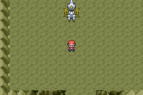

# Cavernas e grupos lendários

As 105 espécies especiais estão distribuídas em 48 cavernas ou câmaras existentes. Cada uma tem um nome próprio no aviso de entrada e no menu MAP. Pares, trios, famílias e grupos diretamente relacionados ficam juntos; espécies sem esse vínculo ficam separadas. A maior família é a dos seis Regis. Nenhum lendário foi removido.

Os acessos, terrenos, treinadores e demais eventos nativos das cavernas foram preservados. Os mesmos flags de captura impedem duplicação de Pokémon já capturados. O Pokédex aponta para os novos locais.

No navio abandonado, Dialga e Palkia continuam presos; a luta contra Giratina permanece obrigatória e sem captura. Após a conclusão, Dialga, Palkia e Giratina ficam disponíveis na Creation Cave, onde também fica Arceus. Crystal, Globe e Core continuam como recompensas.

A imagem da Creation Cave foi capturada na ROM com a conclusão do capítulo preparada no emulador. O capítulo inteiro não foi refeito nesta validação.

| Caverna / câmara | Grupo | Interior existente |
|---|---|---|
| STORMBIRD CAVE | Articuno, Zapdos, Moltres | JourneySanctuaryTempestades |
| RAINBOW CAVE | Lugia, Ho Oh | JourneySanctuaryAurora |
| PRIMAL CAVE | Kyogre, Groudon, Rayquaza | JourneySanctuaryVulcao |
| TITAN CAVE | Regirock, Regice, Registeel, Regigigas, Regieleki, Regidrago | JourneySanctuaryTitans |
| TIMEGROVE CAVE | Celebi | JourneySanctuaryFloresta |
| MOON-DREAM CAVE | Cresselia, Darkrai | JourneySanctuaryEclipse |
| TAO CAVE | Reshiram, Zekrom, Kyurem | JourneySanctuaryDragoes |
| EON CAVE | Latias, Latios | JourneySanctuaryEstrelas |
| LAKE SPIRIT CAVE | Uxie, Mesprit, Azelf | JourneySanctuaryCristais |
| SEA CROWN CAVE | Phione, Manaphy | JourneySanctuaryMares |
| CREATION CAVE | Dialga, Palkia, Giratina Altered, Arceus Normal | JourneySanctuaryOrigens |
| NATURE FORCE CAVE | Tornadus Incarnate, Thundurus Incarnate, Landorus Incarnate, Enamorus Incarnate | JourneySanctuaryProfundezas |
| COSMIC LIGHT CAVE | Cosmog, Cosmoem, Solgaleo, Lunala, Necrozma | JourneySanctuaryDimensoes |
| GLASS TIDE CAVE | Nihilego | JourneySanctuaryAbismo |
| THUNDERBEAST CAVE | Raikou, Entei, Suicune | JourneyCaveFarol |
| JUSTICE CAVE | Cobalion, Terrakion, Virizion, Keldeo Ordinary | JourneyCaveBrisa |
| AURA BALANCE CAVE | Xerneas Neutral, Yveltal, Zygarde 50 | JourneyCaveHorizonte |
| GENESIS CAVE | Mewtwo, Mew | JourneyCaveCoral |
| ISLAND GUARD CAVE | Tapu Koko, Tapu Lele, Tapu Bulu, Tapu Fini | JourneyCaveAlvorada |
| HERO CAVE | Zacian Hero, Zamazenta Hero, Eternatus | JourneyCaveEspuma |
| CROWNED TUNDRA | Glastrier, Spectrier, Calyrex | JourneyCaveOcaso |
| MASKBOUND CAVE | Okidogi, Munkidori, Fezandipiti, Ogerpon Teal, Pecharunt | JourneyCaveMare |
| LIVEWIRE CHAMBER | Xurkitree | GraniteCave 1F |
| INSECT RIFT | Buzzwole, Pheromosa | GraniteCave B1F |
| BLADE-ROCKET RIFT | Celesteela, Kartana | GraniteCave B2F |
| ABYSSAL HUNGER | Guzzlord | GraniteCave StevensRoom |
| VENOM DRAGON DEN | Poipole, Naganadel | MeteorFalls 1F 1R |
| BURST-ASSEMBLY DEN | Stakataka, Blacephalon | MeteorFalls 1F 2R |
| CHIMERA CHAMBER | Type Null, Silvally Normal | MeteorFalls B1F 1R |
| QUICKSILVER CAVE | Meltan, Melmetal | MeteorFalls B1F 2R |
| TWIN-FIST CAVE | Kubfu, Urshifu Single Strike | MeteorFalls StevensCave |
| SEALED RUIN CAVE | Wo Chien, Chien Pao, Ting Lu, Chi Yu | ShoalCave LowTideInnerRoom |
| PARADOX DRAGON DEN | Koraidon, Miraidon | ShoalCave LowTideLowerRoom |
| TERASTAL CHAMBER | Terapagos Normal | ShoalCave LowTideIceRoom |
| WISHSTAR CHAMBER | Jirachi | FieryPath |
| METEOR HEART | Deoxys Normal | RusturfTunnel |
| MAGMA HEART | Heatran | VictoryRoad 1F |
| VICTORY FLAME | Victini | VictoryRoad B1F |
| MELODY CHAMBER | Meloetta Aria | VictoryRoad B2F |
| PALEO ARMORY | Genesect | VictoryRoad 1F Frlg |
| DIAMOND CHAMBER | Diancie | VictoryRoad 2F Frlg |
| RINGBOUND CHAMBER | Hoopa Confined | VictoryRoad 3F Frlg |
| STEAMBOUND CAVE | Volcanion | RockTunnel 1F Frlg |
| SOUL HEART CHAMBER | Magearna | RockTunnel B1F Frlg |
| SHADOWSTEP CAVE | Marshadow | MtMoon 1F Frlg |
| THUNDERCLAW CAVE | Zeraora | MtMoon B1F Frlg |
| VINEGUARD CAVE | Zarude | MtMoon B2F Frlg |
| GRATITUDE GROTTO | Shaymin Land | CeruleanCave 1F Frlg |
