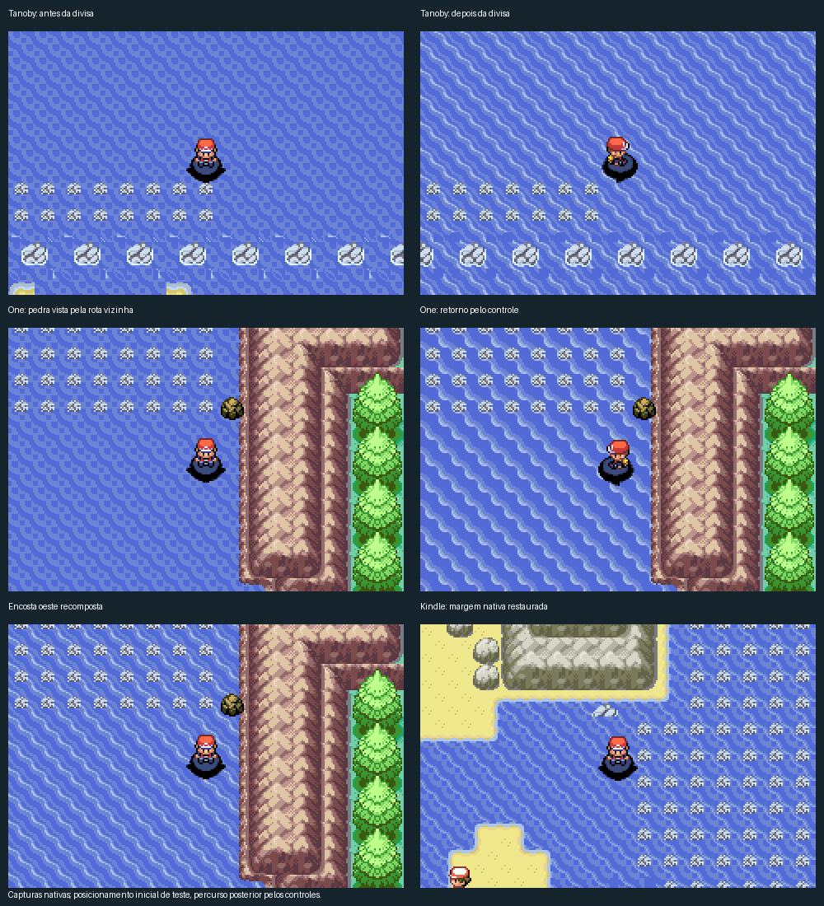

# Objetos inteiros e continuidade costeira

A revisão 170 amplia a busca a outras rotas e ilhas. Recompõe 38 rochas
incompletas, recupera 70 peças nativas de encosta e praia e alinha 107 posições
contraditórias nas curvas do oceano. A pedra permanente de One Island passa
a aparecer antes da travessia, também na câmera da rota vizinha.

O ajuste de Tanoby conserva a arte já usada por WorldSea06/07 e seleciona o
banco da costa vizinha para a rocha projetada no canto. Os IDs sozinhos não
provavam compatibilidade: os bancos escolhiam paletas diferentes nessa rocha.

O mapa-múndi, as coordenadas, os eventos e as conexões permanecem iguais.
O censo de fonte cobre 284 mapas, com renders inteiros antes/depois e NPCs;
as provas nativas verificam as câmeras, obstáculos, animação e saves.
O recorte não representa quatro campanhas completas.

- [Reprodução, causas, soluções e método em TXT](../errors/2026-11-06-objetos-e-cantos-costeiros.txt)
- [Provas da revisão](../mods/hoenn/coast-scenery-review-validation/)
- [Manifesto das ROMs atuais](../mods/hoenn/versions/versions.json)
