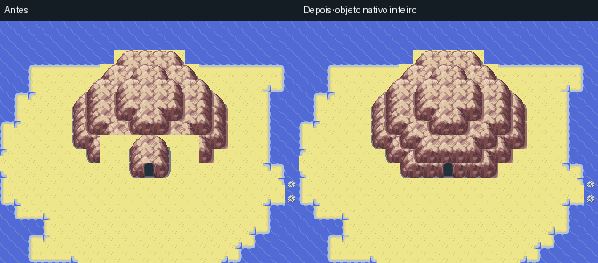
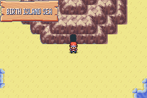

# Montanhas completas das cavernas costeiras

A foto corresponde ao acesso do santuário Cristais em `JourneyWorldSea08`. O mesmo defeito estava nas outras oito ilhas de santuário: uma revisão anterior apagou uma janela de 7 × 3 tiles da frente da montanha e inseriu uma caverna pequena, deixando uma linha horizontal cortada e fragmentos pendurados nas laterais.

A correção restaura o objeto nativo inteiro de Seafoam, copiado de `Route20_Frlg`, com 81 tiles. Cada ilha muda somente 19 tiles dentro dessa montanha. A porta mantém posição, altura e destino; praias, rotas de Surf, NPCs, encontros e mapa-múndi permanecem iguais. Todo tile seco útil fora do objeto continua ligado à entrada.

As imagens são **renderizações dos tiles de origem**, não capturas de emulador. Os mapas completos antes e depois estão registrados em [review.json](cavernas-costeiras/review.json); a [galeria das nove montanhas](cavernas-costeiras/nove-montanhas-completas.png) mostra a revisão do objeto e da costa ao redor.

| Acesso | Santuário | Antes | Depois |
|---|---|---|---|
| WorldSea00 | Tempestades | [Mapa](cavernas-costeiras/JourneyWorldSea00-before.png) | [Mapa](cavernas-costeiras/JourneyWorldSea00-after.png) |
| WorldSea01 | Aurora | [Mapa](cavernas-costeiras/JourneyWorldSea01-before.png) | [Mapa](cavernas-costeiras/JourneyWorldSea01-after.png) |
| WorldSea02 | Vulcão | [Mapa](cavernas-costeiras/JourneyWorldSea02-before.png) | [Mapa](cavernas-costeiras/JourneyWorldSea02-after.png) |
| WorldSea03 | Titãs | [Mapa](cavernas-costeiras/JourneyWorldSea03-before.png) | [Mapa](cavernas-costeiras/JourneyWorldSea03-after.png) |
| WorldSea04 | Floresta | [Mapa](cavernas-costeiras/JourneyWorldSea04-before.png) | [Mapa](cavernas-costeiras/JourneyWorldSea04-after.png) |
| WorldSea05 | Eclipse | [Mapa](cavernas-costeiras/JourneyWorldSea05-before.png) | [Mapa](cavernas-costeiras/JourneyWorldSea05-after.png) |
| WorldSea06 | Dragões | [Mapa](cavernas-costeiras/JourneyWorldSea06-before.png) | [Mapa](cavernas-costeiras/JourneyWorldSea06-after.png) |
| WorldSea07 | Estrelas | [Mapa](cavernas-costeiras/JourneyWorldSea07-before.png) | [Mapa](cavernas-costeiras/JourneyWorldSea07-after.png) |
| WorldSea08 | Cristais | [Mapa](cavernas-costeiras/JourneyWorldSea08-before.png) | [Mapa](cavernas-costeiras/JourneyWorldSea08-after.png) |

A revisão de origem verifica o recorte inteiro contra o mapa doador, preservação dos acessos e reaplicação sem mudanças adicionais. A validação nativa final passou nas quatro ROMs normais e na TESTE: nove cavernas por edição, duas idas e voltas por caverna, totalizando 90 idas e voltas e 180 trocas de mapa. Cada execução confere os 81 tiles da montanha carregados na ROM, o desembarque, a caminhada até a porta, a entrada, a saída e o retorno ao Surf.

As provas com o SHA de cada ROM estão em `mods/hoenn/dewford-coast-validation/<edição>/coastal-cave-finishing.json`. Apenas o ponto inicial de Surf, a equipe e as insígnias são preparados pelo teste; os percursos seguintes usam os controles, sem alterar posição ou altura. Essa prova cobre os acessos das cavernas; não representa uma campanha completa nem o teste de abertura da TESTE, registrado separadamente.

