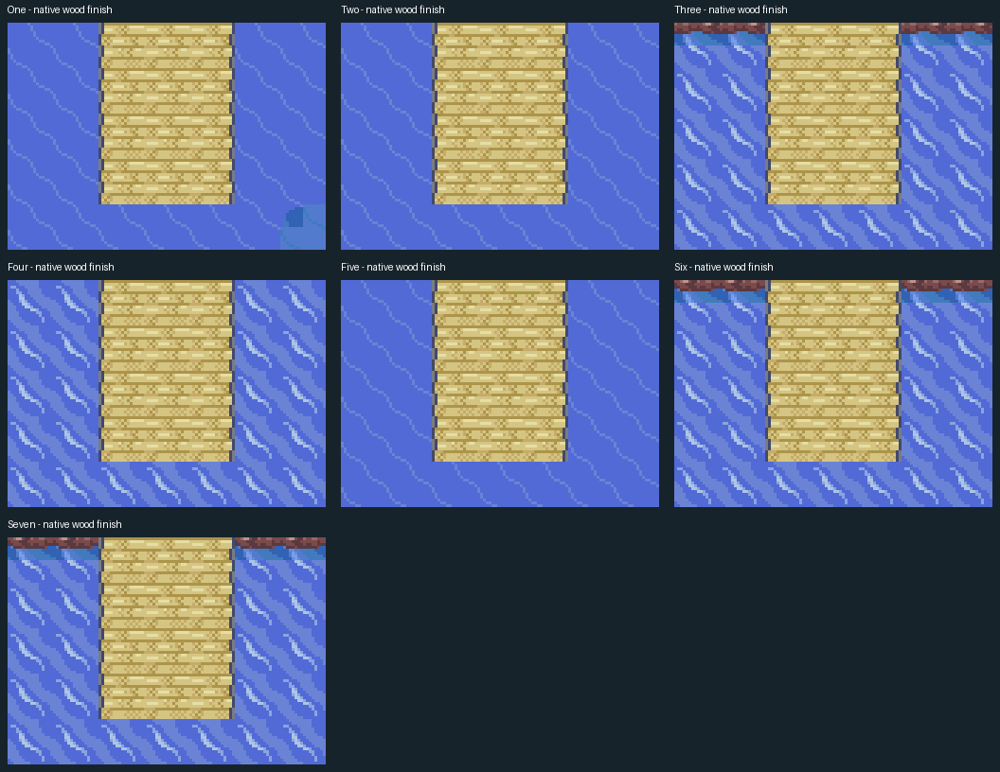

# Pontes das sete Sevii

As sete rampas das cidades foram prolongadas com tábuas nativas de três tiles de largura sobre a área ocupada pelos telhados antigos. Os terminais completos, barcos, NPCs e conexões de mar foram preservados. Em One Island, a ponte atravessa a emenda real com Treasure Beach; a saída do ferry passou para sua extremidade, com o retorno correspondente.

As sete pontas agora terminam em madeira, sem a faixa metálica. Três metatiles privados copiam as tábuas nativas e preservam os comportamentos originais da ponta: o tile central continua acionando a saída para o terminal. Os degraus metálicos originais fora dessas pontas continuam intactos. Os detalhes `*-wooden-end.png` mostram o acabamento de cada ilha.

Os tablados baixos dos terminais bloqueiam novas entradas de Surf. A água livre ao redor continua navegável. Isso impede que a cabeça e o corpo do personagem fiquem cobertos pelas tábuas. A ponte alta de Dewford conserva a passagem de Surf por baixo.

As imagens `*-before.png`, `*-after.png` e `*-comparison.png` são renderizações dos mapas completos a partir dos tiles e NPCs nativos, e não capturas do emulador. Em cada imagem, a cidade fica à esquerda e o terminal principal à direita. One inclui Treasure Beach inteiro, para mostrar a emenda. O arquivo `renders.json` identifica os mapas e os hashes das ROMs de origem.

A validação funcional usa `tools/hoenn/validate_coastal_pier_safety.py`: percorre cada linha das sete pontes com controles, chega ao terminal e retorna sem reposicionamento durante o percurso. Também tenta entrar pelo lado do tablado usando Surf, percorre o mar livre nos dois sentidos e cruza todas as 25 conexões de superfície dos sete terminais nos dois sentidos (Two tem duas; Three tem três; os demais têm quatro). Partida, equipe e progresso são preparados como fixtures; a validação não representa uma campanha completa.

A prioridade de desenho é conferida conforme o tile nativo: chão e tábuas comuns de altura 3 usam prioridade 2, enquanto os tablados de múltiplas alturas usam prioridade 1 para o pedestre. Todos os pedestres mantêm altura 3 e visibilidade; Surf mantém altura 1 e prioridade 2. O teste da margem oeste usa água realmente livre, preservando o recife original de Two Island.

O validador também compara os três metatiles de madeira e seus atributos nos dados compilados da ROM, além de conferir os IDs, os comportamentos e a altura das três peças da ponta carregadas no mapa. As capturas `*-wooden-endcap-visible.png` de cada edição registram o resultado no emulador.

A matriz final passou nas cinco ROMs com o acabamento em madeira: 35 pontas carregadas e verificadas, 125 idas e voltas nas conexões marítimas e 250 trocas de mapa por controles. A [síntese nativa](native-validation.json) vincula cada resultado ao SHA da ROM final e inclui a revisão adicional do salvamento no píer, dos terminais e do Centro de Six Island.

| Ilha | Antes/depois do mapa completo |
| --- | --- |
| One | [One-comparison.png](One-comparison.png) |
| Two | [Two-comparison.png](Two-comparison.png) |
| Three | [Three-comparison.png](Three-comparison.png) |
| Four | [Four-comparison.png](Four-comparison.png) |
| Five | [Five-comparison.png](Five-comparison.png) |
| Six | [Six-comparison.png](Six-comparison.png) |
| Seven | [Seven-comparison.png](Seven-comparison.png) |

Validação final: as cinco ROMs passaram com seus próprios hashes. Foram 35 pontes percorridas, 35 tablados com bloqueio de Surf conferido e 125 idas e voltas pelas conexões marítimas (250 trocas de mapa por controles). O relatório adicional da ROM base também passou pelas sete portas, salvamento/continuação no píer, Centro Pokémon de Six Island e margens de Two e One/Treasure Beach. Os hashes e caminhos das provas estão em [native-validation.json](native-validation.json).
