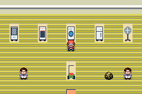
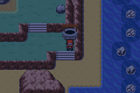

# Encontros especiais e mudanças de forma

Estas 21 famílias têm aquisição por evento ou restauração. Nenhuma delas continua nos encontros aleatórios de grama, cavernas, Surf ou pesca. As evoluções são obtidas a partir do Pokémon inicial da família. Lendários, míticos e Paradoxos continuam no índice separado e exigem as 16 insígnias.

Os novos encontros comuns seguem a média de nível da equipe −5/+2. Rotom, Spiritomb, Unown e Gimmighoul não exigem uma Liga. Fugir ou perder permite nova tentativa. Rotom, Spiritomb e Gimmighoul param de aparecer após a captura; o glifo de Unown continua disponível para suas letras.

| Família | Local e método |
|---|---|
| Rotom | Torre Pokémon, Lavender: escada lateral à direita no primeiro andar, (21, 9). A TV fica em (2, 4) na oficina. |
| Spiritomb | Memorial Pillar, Sevii 5: poço em (16, 47). |
| Unown | Monean Chamber, Tanoby Ruins, Sevii 7: glifo em (11, 8). |
| Gimmighoul Chest | Lost Cave, Sevii 5: Room 10, baú em (7, 5). |
| Castform Normal | Instituto Meteorológico, Rota 119, segundo andar: cientista original, depois de Shelly. |
| Porygon | Celadon Game Corner: balcão de prêmios Pokémon, usando moedas e Coin Case. |

## Rotom e Deoxys

Capture somente Rotom base na TV com estática. Interaja com um eletrodoméstico da oficina, escolha Rotom na equipe e selecione o aparelho no catálogo: forno, lavadora, geladeira, ventilador ou cortador. LIGHT BULB devolve a forma base. A mudança usa a animação nativa, recalcula os atributos e oferece o golpe do aparelho; se necessário, o jogo pergunta qual golpe substituir. Os golpes exclusivos do aparelho anterior são retirados.

O meteoro dentro da mesma oficina alterna Deoxys entre Normal, Attack, Defense e Speed. Ele não entrega nem consome o Meteorite da história de Hoenn.

## Odd Keystone e fósseis

O explorador na Altering Cave de Hoenn, (4, 5), entrega um conjunto inicial de fósseis e o Odd Keystone. O conjunto de fósseis é entregue uma vez. A pedra é instalada no poço de Memorial Pillar e consumida uma vez; novas tentativas após fuga não exigem outra pedra. A instalação fica no save.

O cientista no primeiro andar do Museu de Pewter, (24, 7), oferece uma lista de restauração com rolagem. A lista mostra apenas as espécies permitidas na edição. O Pokémon vai à equipe ou ao PC; fósseis não são consumidos se não houver espaço. Os laboratórios originais de Cinnabar e Devon continuam com suas restaurações antigas. A nova marcação de área aponta o centro universal de Pewter.

| Pokémon inicial | Material necessário |
|---|---|
| Omanyte | Helix Fossil |
| Kabuto | Dome Fossil |
| Aerodactyl | Old Amber |
| Lileep | Root Fossil |
| Anorith | Claw Fossil |
| Cranidos | Skull Fossil |
| Shieldon | Armor Fossil |
| Tirtouga | Cover Fossil |
| Archen | Plume Fossil |
| Tyrunt | Jaw Fossil |
| Amaura | Sail Fossil |
| Dracozolt | Fossilized Bird + Fossilized Drake |
| Arctozolt | Fossilized Bird + Fossilized Dino |
| Dracovish | Fossilized Fish + Fossilized Drake |
| Arctovish | Fossilized Fish + Fossilized Dino |

Os fósseis até Shieldon funcionam nas edições 1–4; os posteriores ficam nas edições 1–9. As formas regionais e Megas de espécies até #493 continuam permitidas.

## Outros itens de mudança de forma

O cientista da oficina entrega os seguintes recursos sem duplicar os que já estão na Bag. Eles usam os sistemas nativos dos respectivos Pokémon. Fusão exige os parceiros corretos na equipe; Gracidea depende das condições de Shaymin e do horário. Megas continuam exigindo suas pedras próprias e os Origin Orbs de Dialga, Palkia e Giratina continuam sendo recompensas da história Galactic.

Rotom Catalog, Gracidea, Reveal Glass, Dna Splicers, Zygarde Cube, Prison Bottle, N Solarizer, N Lunarizer, Reins Of Unity, Red Nectar, Yellow Nectar, Pink Nectar, Purple Nectar, Fire Memory, Water Memory, Electric Memory, Grass Memory, Ice Memory, Fighting Memory, Poison Memory, Ground Memory, Flying Memory, Psychic Memory, Bug Memory, Rock Memory, Ghost Memory, Dragon Memory, Dark Memory, Steel Memory, Fairy Memory, Flame Plate, Splash Plate, Zap Plate, Meadow Plate, Icicle Plate, Fist Plate, Toxic Plate, Earth Plate, Sky Plate, Mind Plate, Insect Plate, Stone Plate, Spooky Plate, Draco Plate, Dread Plate, Iron Plate, Pixie Plate, Douse Drive, Shock Drive, Burn Drive, Chill Drive, Cornerstone Mask, Wellspring Mask, Hearthflame Mask.

Formas automáticas em batalha, como Castform sob clima, continuam sendo automáticas. Evoluções por pedras, doces e itens continuam no [guia de itens e evoluções](itens-e-evolucoes.md).

## Validação

Nas quatro edições foram exercitados a entrada/saída da oficina, captura real de Rotom com Master Ball preparada no teste, seis escolhas do catálogo, quatro formas de Deoxys, instalação/consumo único do Keystone, save/reload, receitas dos fósseis e consultas nativas das novas áreas na Pokédex. Viagem, equipe e itens iniciais são fixtures declaradas; isso não equivale a jogar a campanha inteira. Os demais recursos de forma utilizam os callbacks existentes e não foram todos exercitados por menus nesta atualização.
