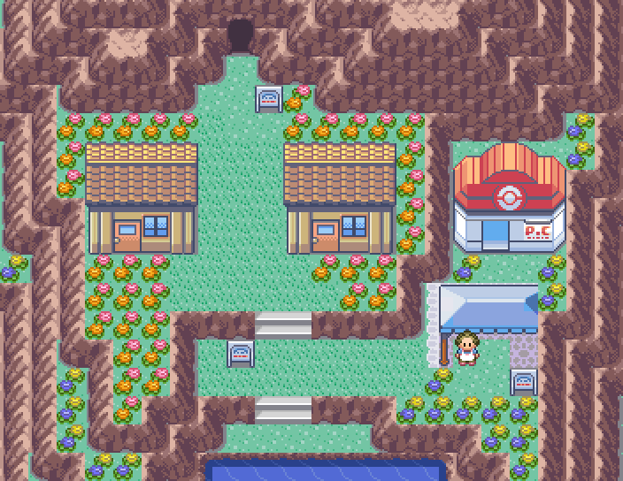
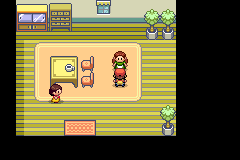
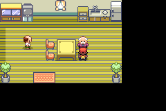
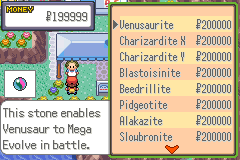
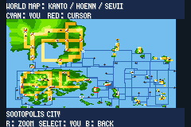

# Casas e feira de Ever Grande

Duas casas ficam nos antigos canteiros em frente ao Centro Pokémon de Ever Grande. Cada uma tem dois moradores e um interior mobiliado diferente. O caminho central, as duas escadas e os acessos ao Centro Pokémon e à Victory Road continuam livres.

| Casa | Presente |
| --- | --- |
| À esquerda | 1 Full Restore |
| À direita | 1 Max Revive |

Os presentes são únicos por save. Se a mochila estiver cheia, o morador guarda o item até haver espaço. Conversar novamente ou salvar e continuar não duplica o presente.

A barraca azul ao lado do Centro Pokémon usa o modelo da feira de Slateport. O vendedor oferece as Mega Stones do jogo por **₽200.000 cada**. O preço é exclusivo dessa barraca; os valores comuns dos itens e das outras lojas continuam os mesmos.

O marcador vermelho de Sootopolis foi restaurado no mapa e no zoom. A Cave of Origin continua dentro da cidade, com seu nome e posição cadastrados; seu símbolo não cobre mais a cidade.

As quatro [ROMs normais](../roms/README.md) e a [ROM de teste](../roms/rom-de-teste/LEIA-ME.md) incluem esta atualização. A ROM de teste continua sem encontros selvagens nem abordagem automática de treinadores.

A validação em mGBA percorre as portas das duas casas e do Centro Pokémon, testa a mochila cheia, a entrega única, conversas repetidas, uma compra por ₽200.000, a recusa com ₽199.999 e o save/continue. As cinco ROMs têm relatórios próprios com seus hashes em `mods/hoenn/ever-grande-market-validation/`. A reprodução independente da camada verifica todos os arquivos anteriores e preserva as rotas de Surf; os testes extensos dessas rotas continuam anexados à compilação anterior, com os hashes originais.
