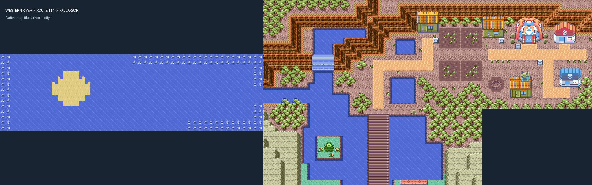
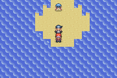
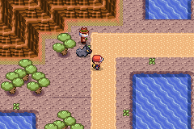
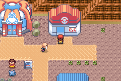
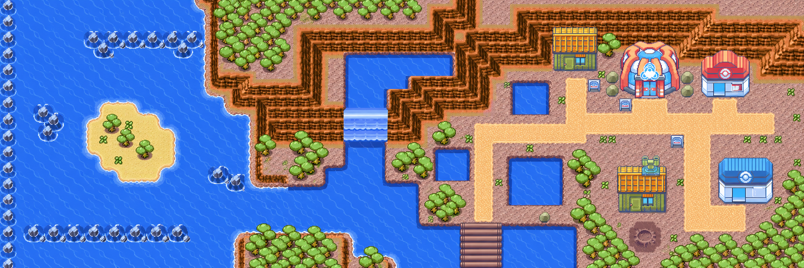

# Rio de Fallarbor: margens e desembarque

A abertura retangular antiga removia partes do paredão e dos arbustos na Rota 114. O contorno nativo foi restaurado e os recifes soltos foram retirados da boca do lago. Os arbustos da margem ficam completos e bloqueiam a passagem sob as folhas. As pedras que fecham os limites do Western River usam o desenho inteiro de um único metatile.

A praia da ilhota tem contorno fechado, areia com elevação de terra e os dois treinadores nas mesmas posições. A pequena poça no meio da margem de desembarque foi preenchida, formando um caminho contínuo até Fallarbor. Prédios, entradas de cavernas, NPCs, scripts e conexões mantêm suas posições e funções.

[Vídeo atualizado no mGBA, com a ROM Gen 1–9 Normal](videos/western-river-fallarbor.mp4). A gravação começa a pé na praia, usa o diálogo nativo de Surf, entra na Rota 114, sobe e desce a cachoeira com Waterfall e desembarca para seguir a pé até Fallarbor. A cachoeira continua dando acesso ao lago superior; o caminho da cidade sai da margem do lago inferior.

As quatro edições normais e a ROM de teste têm validação própria, vinculada ao SHA-256 de cada ROM, em `mods/hoenn/ever-grande-market-validation/`. O teste percorre cinco pontos da praia a pé, ativa Surf pelos controles, atravessa nos dois sentidos as ligações com Cinnabar South Sea, Rustboro Coast e Rota 114, testa o bloqueio das pedras e dos arbustos, chega à cidade, retorna à praia e salva/continua em terra. Os deslocamentos depois da partida não usam teletransporte nem escrita de coordenadas.

O grupo inicial, o progresso anterior e a posição inicial são fixtures. A gravação usa o relógio ao meio-dia para mostrar as cores. As edições normais continuam com seus encontros e treinadores; a ROM de teste conserva o modo de inspeção separado.

## Referência visual

Proposta gerada a partir dos mapas da região para orientar o contorno das margens, o estilo do paredão e a praia. As imagens anteriores e o vídeo mostram o terreno aplicado com os tiles do jogo.
