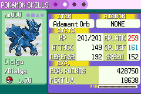
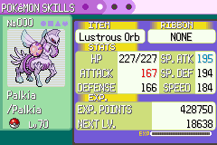
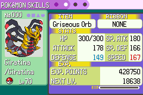

# Dialga, Palkia e Giratina Origin

Equipar o item correto transforma o Pokémon imediatamente. Retirar o item ou trocar por um incompatível restaura a forma normal, com recálculo dos atributos. O item permanece equipado e a transformação não o consome.

| Pokémon | Orb que agora transforma | Item da missão que continua funcionando |
|---|---|---|
| Dialga | Adamant Orb | Adamant Crystal |
| Palkia | Lustrous Orb | Lustrous Globe |
| Giratina | Griseous Orb | Griseous Core |

Os Orbs mantêm seus efeitos de aumento de poder. A missão Galactic, com Eren, Luffy, os administradores e Cyrus no navio abandonado, e seus prêmios foram preservados. As formas estão disponíveis nas quatro edições normais e na ROM de teste, inclusive nas edições até a geração 4 porque as três espécies pertencem a essa geração.

As imagens abaixo foram capturadas na ROM, após equipar os Orbs pelo menu GIVE da Bag.

A validação usa Pokémon, itens e posição iniciais preparados no emulador. Equipar, retirar os Orbs e abrir o resumo usam controles reais. Os três itens modernos também foram conferidos pelo método nativo de transformação. Foram verificados os atributos antes/depois, o retorno à forma normal, a persistência após salvar/carregar e a rejeição de um Orb de outra espécie. Não foi refeito o capítulo Galactic completo nesta alteração.
