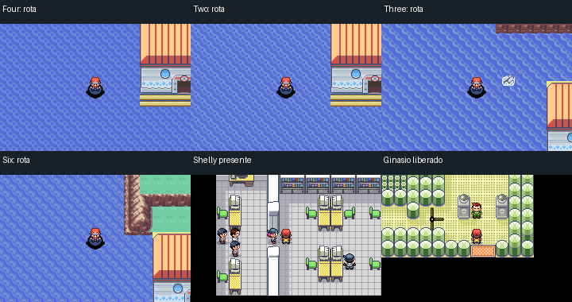

# Continuidade da campanha e câmeras costeiras

Esta revisão trata de dois defeitos reproduzidos na ROM 167: Shelly pode ficar
invisível na etapa obrigatória do Instituto do Clima, e os terminais de algumas
Sevii aparecem desfigurados enquanto são vistos da rota vizinha.

No Instituto, o seletor da campanha exige o evento 15, mas a visibilidade da
chefe usava o evento 14, da crise de Rayquaza. A correção compartilha os nomes
desses identificadores, mantendo seus valores e os scripts de progresso.
O percurso venceu a batalha, recebeu Castform, saiu pela Rota 119, entrou
no ginásio de Fortree e retomou o save. Também corrige o segundo bloqueio:
o estado nativo passa de 1 para 2 ao sair do Instituto; a conclusão conserva
esse estágio a missão cumprida, exigindo ainda a derrota de Shelly.

Nas costas, a câmera usa os bancos do mapa em que o jogador ainda está para
desenhar parte do vizinho. Uma rota com o banco antigo não consegue desenhar
as peças ampliadas do terminal da ilha. O ajuste usa bancos existentes após
conferir o terreno da própria rota e os trechos visíveis dos vizinhos.

As reproduções e o roteiro de prevenção ficam no
[registro em TXT](../errors/2026-11-04-campanha-e-cameras.txt). Os relatórios da
próxima ROM ficarão em
[`game-continuity-review-validation/`](../mods/hoenn/game-continuity-review-validation/).

As provas anteriores permanecem vinculadas às ROMs anteriores. Os estados
iniciais preparados para os testes de capítulos são declarados; esses testes
não equivalem a jogar quatro campanhas completas do New Game aos Hall of Fame.

ROM-base da validação: `cd91b1a3b8b783fe860c6668a7efcc741e847d198f0363b2288e382045e55479`.
ELF: `ab5dbf1fbb10d335adde96a972e352d4a1f3a35158cc1513ee67bd71d6ee5103`.

Foram conferidos 16 mapas ajustados, 32 travessias por controles e 304 imagens
de câmeras/água. A comparação de fonte cobre as 92 conexões direcionais
afetadas; esses números representam coberturas diferentes. Os 447 tiles do
percurso do Instituto incluem a entrada bloqueada, a batalha, a recompensa,
a porta liberada e o retorno. A retomada usa a bateria nativa exportada, sem
escrever memória no boot.

A ferramenta de revisão passou a resolver aliases, tabelas de quadros e os
bytes nativos dos sprites. Isso recupera 27 atores estáticos que haviam sido
omitidos em renders de 21 mapas; não altera os personagens do jogo. Seletores
variáveis exigem um estado declarado e continuam identificados quando não
resolvidos. Os renders históricos não foram substituídos.

A publicação mantém as quatro normais e a TESTE com os mesmos ajustes.
A TESTE conserva a supressão de encontros aleatórios e abordagens automáticas.
