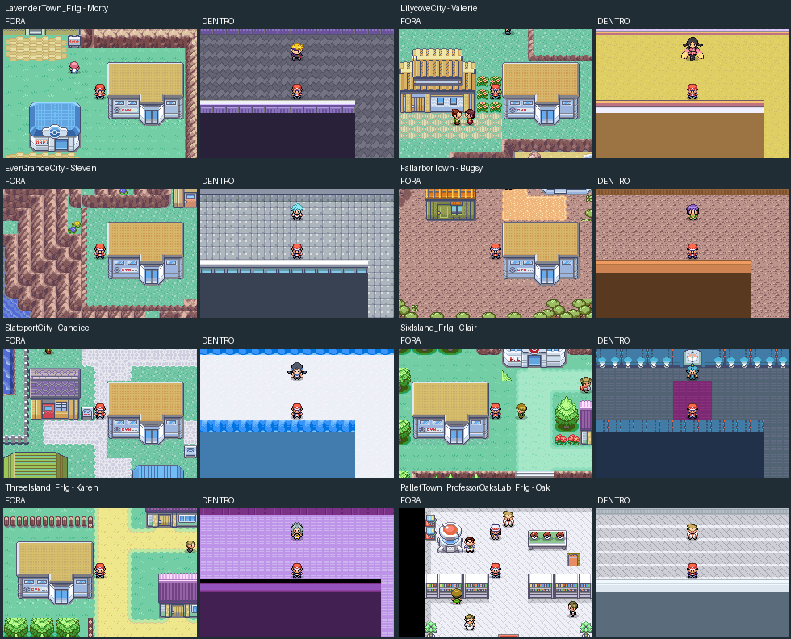
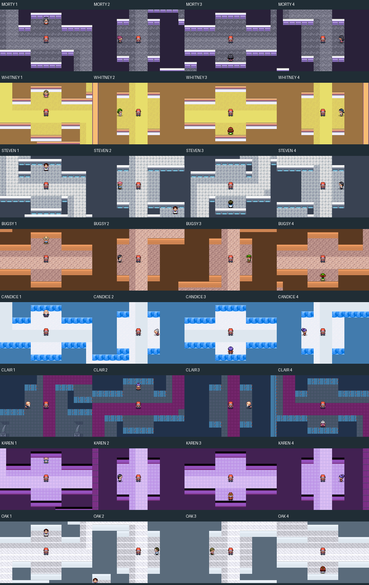
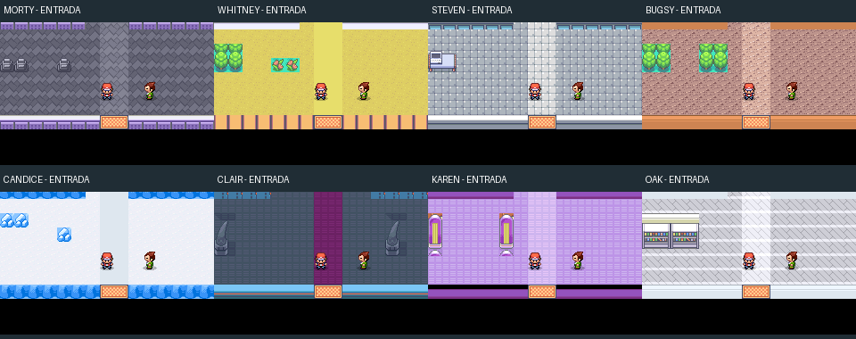
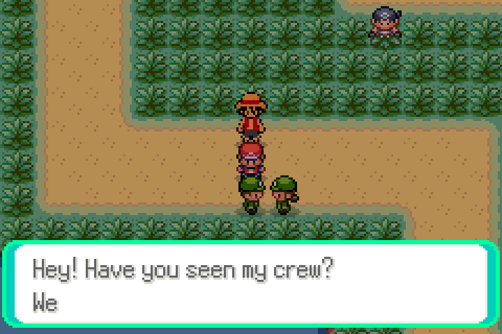
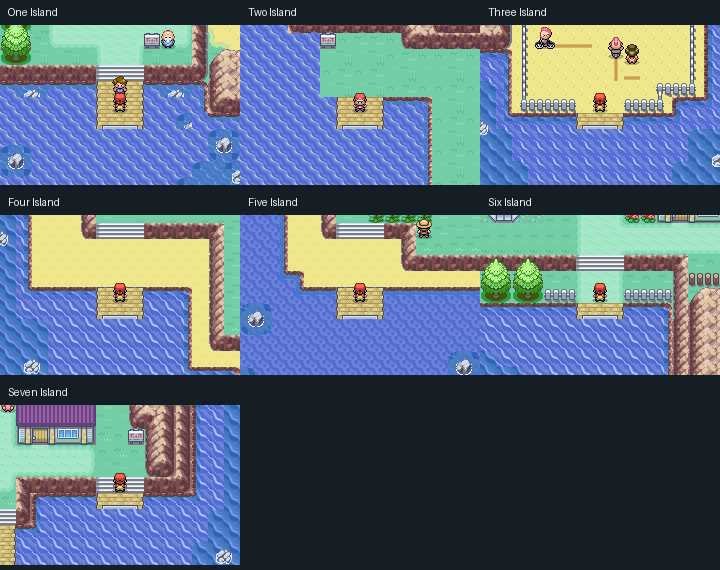
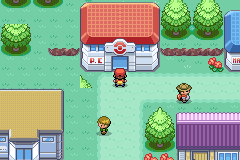
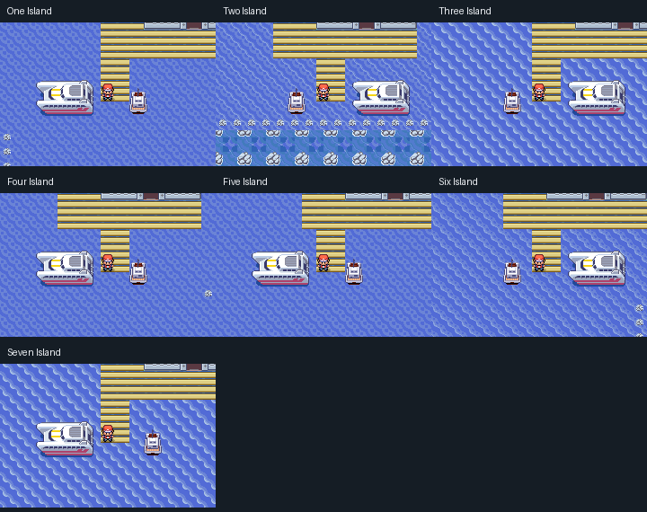

# Circuito de 24 insígnias e revisão das travessias

O circuito mantém os 16 ginásios originais e acrescenta oito. A [camada 164](badge-story.md) muda a admissão das duas Ligas: são necessárias **18 insígnias e a vitória na competição da Battle Frontier**. Os 24 ginásios continuam disponíveis; o capítulo Galactic passa para a 22ª insígnia.

| Local | Tipo | Líder |
|---|---|---|
| Lavender | Fantasma | Morty |
| Lilycove | Fada | Whitney nas edições Gen 1–4; Valerie nas Gen 1–9 |
| Ever Grande | Aço | Steven |
| Fallarbor | Inseto | Bugsy |
| Slateport | Gelo | Candice |
| Sevii, Ilha 6 | Dragão | Clair |
| Sevii, Ilha 3 | Sombrio | Karen |
| Pallet, porão do laboratório de Oak | Misto | Professor Oak |

As fotos usam posições preparadas ao lado das fachadas, ao meio-dia e após sumir a faixa do nome da cidade. A câmera e os pixels são do emulador. As caminhadas, batalhas e portas têm provas funcionais separadas; os mapas inteiros aparecem na revisão visual abaixo.

Oak usa os três iniciais evoluídos de Kanto como base. Whitney usa famílias de Pokémon Fada das gerações 1–4; Valerie tem sua equipe própria. Os líderes adaptam a quantidade de Pokémon ao progresso e as evoluções e golpes ao nível. Os oito novos líderes consideram o total de insígnias. Os 16 originais mantêm sua progressão regional. Cada novo ginásio tem quatro treinadores, guia, líder e uma TM; uma Bag cheia permite buscar a TM depois sem duplicar a insígnia.

Os interiores têm oito plantas próprias, sem repetir um S redimensionado: escadaria de pedra de Morty, estufa de Fada em ferradura, galerias metálicas deslocadas de Steven, viveiro em degraus de Bugsy, retornos na neve caminhável de Candice, santuário com ala lateral de Clair, espiral violeta de Karen e laboratório angular de Oak. As oito sequências de curvas são diferentes e conferidas no validador. Móveis, árvores e estátuas usam conjuntos nativos completos. Não há buracos, gelo deslizante ou portas internas. Os quatro treinadores de cada sala observam corredores livres a até seis tiles e caminham até o jogador nas edições normais. Os sprites dos líderes tiveram a transparência de índice zero restaurada; Candice usa um quadro nativo de 32 × 32 para conservar o corpo inteiro.

O guia fica numa lateral próxima à entrada, olhando para o jogador, com a porta e a passagem central livres. Os quatro aprendizes olham para baixo, direita, cima e esquerda, cruzando o caminho destacado no piso. Divisórias fecham os caminhos alternativos, e cada campo de visão cruza um trecho obrigatório. Os recuos estreitos foram removidos: cada aproximação tem três tiles de largura livres, incluindo as laterais do treinador, por seis tiles de alcance. Nenhuma parede, móvel ou outro NPC ocupa essa faixa. A auditoria remove cada linha de visão separadamente e exige que a entrada perca o acesso ao líder. Nas quatro ROMs normais, o emulador percorre a entrada até o líder e exige as quatro batalhas individuais, na ordem, sem reposicionar o personagem dentro do ginásio. Os corredores permitem continuar ao redor do treinador derrotado. Na TESTE, as aproximações continuam desativadas e os quatro desafios são conferidos por conversa manual. Classes, retratos e sprites variam por especialidade: médiuns, damas, engenheiro e pesquisador de ruínas, caçadores de insetos, veteranos, domador de dragões, guitarrista e cientistas, entre outros.

O Trainer Card alterna entre Hoenn, Kanto e o circuito extra com **L/R/Select** e mostra o total de 24. O acesso ao porão de Oak fica na escada dentro do laboratório. A [competição da 18ª insígnia e o capítulo Galactic da 22ª](badge-story.md) usam os detalhes fornecidos pelo autor. A competição usa somente o espaço do estádio do PWT, com estado e regras próprios.

## Travessias e litoral

O desenho, contorno, cidades e rotas visuais do mapa-múndi foram preservados. A correção altera os caminhos físicos: 55 ligações receberam aproximações e trechos de oceano com curvas ortogonais, distância maior onde havia atalhos desproporcionais e margens fechadas por pedras inteiras. São 192 retângulos de água conectados pelo sistema nativo, sem teletransporte durante a travessia. A antiga conexão de dez passos junto ao canal da Ilha 1 agora contém 255 tiles de percurso.

As aproximações usam o banco gráfico da costa vizinha. A troca de bancos ocorre em água aberta; o cache de margens é reconstruído também quando o jogador desembarca ou passa pelas curvas novas. Isso evita reutilizar árvores, prédios e pedras do lugar anterior como tiles da área seguinte. O GPS recebeu a projeção dos novos trechos sobre as linhas já existentes no atlas.

As portas e os 105 encontros especiais do PR #95 foram preservados. Dezoito fachadas de cavernas tiveram a faixa vertical de água substituída por pedra contínua. A parte sul de Dewford e da Rota 107 conserva o terreno e a borda originais, sem a faixa de mar acrescentada. O vendedor de itens volta a atender junto ao responsável pelo Hyper Training. O mercado da Battle Frontier permanece.

Luffy recebeu nove quadros de caminhada, corpo de 28 pixels visíveis e animação direcional padrão. Flare Blitz foi retirado dos **times de treinadores com Solrock**; a lista de golpes da espécie foi preservada, pois as referências modernas incluem esse golpe.

## ROMs e verificação

As quatro [edições normais](../roms/README.md) mantêm encontros e abordagem de treinadores. A [ROM de teste](../roms/rom-de-teste/LEIA-ME.md) continua separada, sem encontros aleatórios ou abordagem automática; as interações manuais com líderes e lendários permanecem disponíveis.

O player do GitHub Pages oferece também **TESTE · Explore without encounters**, com download e save próprios. Sua ROM deve corresponder à edição Gen 1–9 Normal atual; a publicação verifica essa relação e a abertura das cinco edições no mGBA do navegador.

As evidências desta entrega ficam em [`extra-gyms-validation`](../mods/hoenn/extra-gyms-validation/). Elas distinguem o ROM atual das evidências históricas, com SHA-256 por arquivo. Os testes nativos usam posições iniciais, progresso e equipes preparados para testar as funções; as batalhas usam atributos aumentados do jogador para acelerar o teste. Vitórias, insígnias, TMs, colisões e viagens usam o motor real. Isso não representa uma campanha completa nem uma avaliação de dificuldade.

[Vídeo: Mossdeep até a Ilha 1, usando Surf](videos/surf-connections-repaired.mp4) · [Vídeo: rio e Waterfall até Fallarbor](videos/western-river-fallarbor.mp4)

O código é aplicado pela camada 160, `prepare_extra_gyms.py`, após a camada 159 de Ever Grande. `validate_extra_gym_source.py` reproduz a camada independentemente e compara todos os hashes, flags, tamanhos de save e IDs antigos de TM/HM. `validate_surf_repairs.py` percorre todas as 55 ligações corrigidas nos dois sentidos. A checagem complementar `validate_all_surf_links.py` enumera também as conexões externas antigas com água utilizável: a ROM final passou por 427 ligações recíprocas, em 854 travessias, e por 36 tentativas de atravessar os limites de pedras. `validate_marine_network.py` visita as sete ilhas partindo de Mossdeep e faz a ida e volta entre Kanto e a Ilha 1. `validate_extra_gyms.py` exercita equipes, portas, batalhas, recompensas, Ligas, save e Trainer Card. A publicação é feita por `publish_extra_gyms.py` somente com as evidências das cinco ROMs atuais.

## Desenho e revisão visual obrigatórios

A habilidade [gba-map-review](../.agents/skills/gba-map-review/SKILL.md) orienta futuras edições de mapas, conforme o [AGENTS.md](../AGENTS.md). O autor dispensou explicitamente novas propostas desenhadas. A [proposta inspirada em GBA](design/proposta-gba-portos-ginasios.png) precedeu as revisões anteriores de acabamento; ela não é uma captura da ROM.

A revisão do [mapa inteiro](design/revisao-gba/cidades.png), dos [interiores](design/revisao-gba/interiores.png), das [ilhas](design/revisao-gba/ilhas.png) e dos [sete portos](design/revisao-gba/portos.png) usa os próprios tiles do jogo. Os renderizadores marcam quando uma imagem mostra somente o terreno, por haver gráficos dinâmicos de NPCs. Essas imagens ajudam a revisão humana; não substituem as capturas do emulador.

A montanha à direita da Lavender Tower foi restaurada e unida à borda leste com contorno completo; Morty fica dois tiles mais abaixo, com grama livre entre telhado e rocha. Foram restauradas a parede esquerda e a base do Centro da Ilha 6, replantadas árvores inteiras em Three/Six Island, fechada a lateral do terreno em Lilycove, concluído o pátio montanhoso de Steven e restaurado o telhado do terminal da Ilha 2. A fileira invertida de meias pedras sob seus barcos foi substituída por água e um limite de pedras inteiras. A integridade das fachadas e das entradas dos Centros é comparada com o estado anterior aos ginásios.

A última revisão inclui a base da árvore isolada à direita do Mart da Ilha 6. O ginásio de Karen foi deslocado um tile à esquerda para preservar o caminho amarelo original. Em Fallarbor, apenas a grama desenhada dentro da base do ginásio recebeu a cor do solo local; a fundação cinza e a fachada permanecem completas.

As coberturas antigas abaixo das rampas foram removidas nas sete Sevii, incluindo os retângulos de água de outro padrão. Cada rampa continua levando ao seu terminal completo, com as ligações de Surf da rede preservadas. Os sete retornos recebem comportamento de warp norte com a mesma arte de areia. A ida e volta a pé por cada rampa têm teste próprio, além das travessias por mar.

Na Ilha 1, a remoção inclui também a fachada e os postes que continuavam no mapa vizinho, Treasure Beach. A conexão de água entre os dois mapas permanece aberta e foi percorrida com Surf nos dois sentidos.

Na Ilha 2, a margem ao lado da rampa recebeu um contorno nativo completo, com cantos ligados à falésia existente. O corredor seco foi preservado. A prova percorre Centro Pokémon–rampa–terminal–Centro e verifica os bloqueios da margem a pé e com Surf.

As bordas de areia que herdavam a altura 1 do oceano agora usam a altura 3 de terra: o jogo encerra o Surf ao desembarcar. Ornamentos secos alcançáveis a partir do mar receberam colisão. `validate_coastal_landings.py` testa os componentes corrigidos de praia com controles reais, incluindo desembarque, solicitação nativa de Surf e tentativas de atravessar as estruturas bloqueadas. Posições iniciais e progresso são preparados; o estado de chegada é produzido pelo jogo. Foram conferidos 247 componentes de praia em 16 mapas e 34 tentativas contra ornamentos bloqueados. Testes adicionais percorrem as praias nativas de Dewford e da Rota 107, com desembarque e novo uso de Surf, e comparam a parte sul e as bordas com o original preservado.

Também foram corrigidos 119 tiles de pontes que usavam nível de transição (0). Eles passaram ao nível múltiplo nativo (15), que conserva a altura do pedestre ou de quem surfa por baixo. O teste chega ao fim de cada píer **vindo a pé do terminal** e segura o direcional contra o mar, sem escrever a altura do personagem. Depois percorre a porta nos dois sentidos e confere a parede restaurada e a entrada do Centro da Ilha 6.

A revisão de desenho também confere a prioridade do sprite sobre o píer: pedestres de altura 3 são desenhados acima das tábuas, conservando a colisão de terra; quem surfa mantém a camada inferior. O teste nativo verifica as duas prioridades nos sete portos e percorre a água sob o píer nos dois sentidos.

O teste também salva e continua sobre a ponte e confirma que o pedestre permanece visível, não entra na água a pé e consegue retornar ao terminal.

A revisão de ambientação acrescenta detalhes simples no início das salas: túmulos, flores e plantas completas, consoles metálicos, árvores de viveiro, rochas de gelo, colunas e estantes. O santuário de Clair tem quatro estátuas de dragão completas de 2 × 3 tiles e um tapete contínuo até a líder. Os objetos ficam fora do caminho e das faixas de aproximação.

Por pedido explícito do autor, a parte sul de Dewford e da Rota 107 foi restaurada ao terreno e à borda nativos de vinte linhas. A ampliação de mar ao sul foi removida; não foi criada outra praia. Os dois atendentes da feira mantêm suas posições e funções. O teste compara as linhas sul compiladas com o original e exerce Surf e desembarque na costa nativa.
