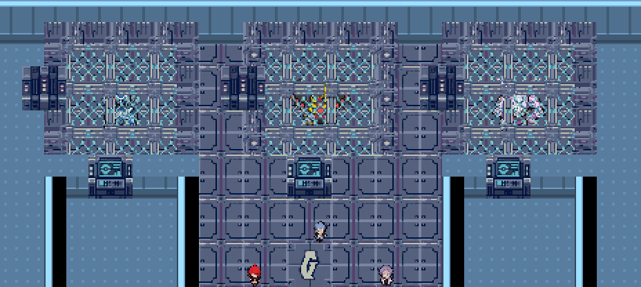

# História e missões obrigatórias

## Exploração Galactic na Diglett’s Cave

O túnel entre a Rota 11, perto de Vermilion, e a Rota 2 tem três exploradores Galactic: dois grunts para batalhar, em (70,60) e (45,38) no andar subterrâneo, e um responsável pelo levantamento em (15,19). Eles explicam que estão explorando Kanto. Os combates são opcionais, acompanham a média atual da equipe e têm flags independentes dos grunts do navio; não criam uma trava de ginásio ou Liga. Os caminhos e as saídas originais foram preservados.

O Rock Tunnel é outro local e mantém a missão anterior com quatro membros do Team Magma. Ambas as cavernas dispensam Flash.

**Este guia contém spoilers.** Os circuitos de ginásios são independentes: insígnias de Kanto contam para a ordem dos ginásios de Kanto e as de Hoenn para Hoenn. As duas Ligas exigem as 16 insígnias e a conclusão das missões obrigatórias, incluindo o capítulo Galactic.

## Kanto

- Após a primeira insígnia, conclua Mt. Moon, derrotando os Rockets e resolvendo a disputa do fóssil. Os itens necessários para encontros originais de história são disponibilizados cedo; Snorlax continua como obstáculo ligado à Poké Flute.
- Após duas insígnias, conclua os episódios dos Rockets em Cerulean/Route 24 e o esconderijo de Celadon antes de avançar nos ginásios.
- Após quatro insígnias, resgate Mr. Fuji na Pokémon Tower e conclua as incursões novas: administrador e grunts Magma em Pewter, administrador e grunts Aqua em Vermilion, Magma em Rock Tunnel, Aqua na travessia marítima oeste e os membros adicionais das equipes nas rotas de Kanto.
- Após seis insígnias, Giovanni deve ser derrotado na Silph Co., em Saffron. Os dois últimos ginásios ficam fechados enquanto esse episódio está pendente.
- Viridian é liderado por Blue e não representa uma nova missão Rocket. O rival de Kanto usa a aparência do personagem jogável do sexo oposto.

## Hoenn

- Após a primeira insígnia, conclua Petalburg Woods e a recuperação dos Devon Goods em Rusturf Tunnel.
- Após duas insígnias, entregue a carta a Steven e os Devon Goods no Oceanic Museum; enfrente Maxie em Mt. Chimney quando essa missão for indicada pelo guia.
- Após quatro insígnias, conclua a base Rocket sob o cassino em Mauville e o episódio de Shelly no Weather Institute.
- Após cinco insígnias, conclua Magma Hideout.
- Após seis insígnias, derrote Matt e conclua a fuga do submarino no esconderijo Aqua de Lilycove.
- Após sete insígnias, Steven ajuda contra Maxie e Tabitha no Space Center. Depois, a missão de Archie em Seafloor Cavern exige também a vitória sobre Giovanni na Silph Co. Giovanni participa como aliado, arrependido, explicando que o propósito inicial da Rocket se perdeu e que quer reparar seus erros.
- Conclua a crise climática de Sootopolis e o episódio de Rayquaza antes do último ginásio de Hoenn.

Os guias dos ginásios fechados indicam o evento pendente e o local. As missões bloqueiam ginásios; as rotas permanecem abertas, com as condições aquáticas de Surf/Dive/Waterfall e as missões de bicicleta.

## Eren e Luffy

Cada um tem seis encontros, três em Kanto e três em Hoenn. A ordem de visita aos locais é livre; as equipes e falas avançam de acordo com as vitórias contra aquele personagem.

| Eren | Luffy |
|---|---|
| Route 4, Kanto | Route 6, Kanto |
| Route 10, Kanto | Route 13, Kanto |
| Route 17, Kanto | Route 20, Kanto |
| Route 112, Hoenn | Route 106, Hoenn |
| Route 113, Hoenn | Route 108, Hoenn |
| Petalburg Woods | Route 125, Hoenn |

Eren suspeita de Magma e fala de seus companheiros de antes do fim da segunda temporada; o contato com a Titã Sorridente é parte do mistério. Luffy está no período após o primeiro Sabaody e suspeita de Aqua e de Kizaru. As doze visitas são obrigatórias antes de entrar no setor final Galactic. Elas continuam disponíveis após obter as 16 insígnias; o guia informa o próximo local que falta visitar.

## Prisão Galactic no navio

Com as 16 insígnias, vá ao Abandoned Ship da Route 108. Use Dive e procure Room 6 no piso inferior oculto. Os habitantes do navio foram substituídos por grunts Galactic; os NPCs originais foram realocados em rotas.

Derrote os 19 grunts, incluindo o guarda do compartimento. Na sala final, Dialga, Giratina e Palkia estão presos em três celas de energia:

1. Você e Eren enfrentam Mars e Pluton/Charon em dupla.
2. Você e Luffy enfrentam Saturn e Jupiter em dupla.
3. Você enfrenta Cyrus sozinho.
4. Giratina enfrenta o jogador numa luta obrigatória, sem captura, com apoio dos aliados. As celas são desativadas após vencer.
5. Cyrus explica as distorções e se arrepende. Eren entrega Adamant Crystal; Luffy entrega Lustrous Globe; Cyrus entrega Griseous Core. Com a bolsa cheia, libere espaço e retome a conversa; a recompensa pendente pode ser recebida depois.
6. Eren e Luffy retornam aos seus mundos. Os três lendários retornam às cavernas, onde podem ser enfrentados e capturados opcionalmente. As Ligas ficam disponíveis quando não há outras missões pendentes.

