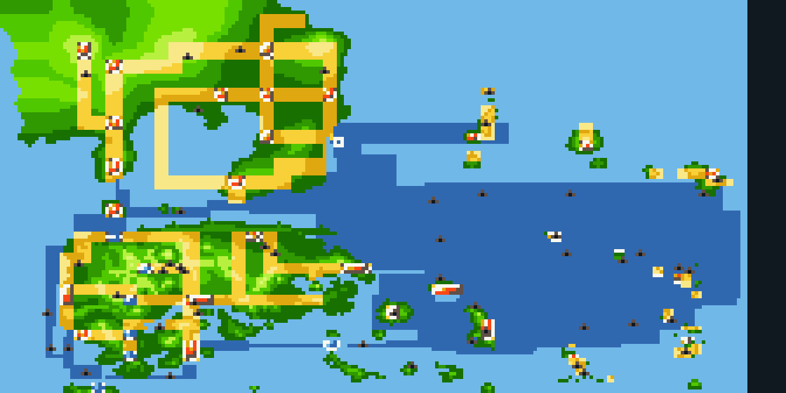
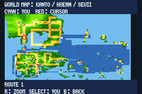
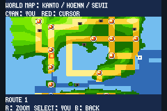
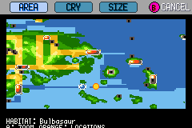

# Navegação e pendências finais

O atlas usa áreas maiores de mar contínuo e elimina as linhas que apenas separavam arquivos internos. As ligações continuam horizontais/verticais. O protótipo desconectado `JourneyHoennCrossing` não aparece como rota disponível. Os terrenos, portos, casas, pontes e barcos aprovados não foram alterados nesta revisão.

## Viagens por controles nativos

Oito viagens de ida e volta percorrem as rotas solicitadas e os 56 mapas de mar gerados com conexões ativas. As viagens usam Surf, desembarque, mudanças de mapa e save/Continue nativos. Somente partida, progresso anterior e equipe são preparados; não há teleporte nem escrita de coordenadas durante os percursos.

| Percurso | Tiles | Transições |
|---|---:|---:|
| Pallet → Rota 21 → Cinnabar → Rota 20 → Rota 19 → Fuchsia → retorno | 894 | 12 |
| Costa de Petalburg → Rotas 105/106 → Dewford → retorno | 382 | 6 |
| Lago da Rota 114 → rio/costa oeste → canal de Dewford → Dewford → retorno | 664 | 14 |
| Rustboro → Rota 115 → canal/costa oeste → Dewford → retorno | 764 | 16 |
| Mares gerados: sudoeste de Kanto e acessos de Lavender/Rota 12 | 1.436 | 26 |
| Mares gerados: corredor oeste de Hoenn | 376 | 8 |
| Mares gerados: canais de Kanto e oceano ao norte de Hoenn/Sevii | 1.080 | 25 |
| Mares gerados: oceano leste e sul de Hoenn/Sevii | 1.872 | 45 |

A soma é 7.468 tiles e 152 transições. Rare Candies, equipe no nível 100 e Max Repel são recursos do **save de teste**, sem modificar o balanceamento entregue. Essas viagens não comprovam dificuldade nem uma campanha completa.

## Marcador e cavernas

A tabela de GPS cobre 408.618 tiles. Todos os pares de tiles adjacentes foram conferidos no binário: avanço máximo de dois pixels por passo e posições idênticas nas bordas compartilhadas. Os percursos observados confirmam essas propriedades na movimentação por controles. O atlas continua uma representação reduzida; essas verificações não significam correspondência de um pixel do desenho a um tile físico.

Foram cadastrados pontos próprios para 145 andares de cavernas originais a partir de suas saídas exteriores. Granite Cave, Diglett’s Cave, Rock Tunnel e Shoal Cave deixam de apontar para Petalburg. Seafoam e as cavernas novas mantêm suas localizações.

## O que ainda falta para a versão final de campanha

Os trajetos marítimos não substituem New Game até os dois Hall of Fame nas quatro edições. Também continuam pendentes a auditoria externa das equipes originais ainda não conferidas do PWT, a cobertura de personagens de Legends Z-A e testes prioritários de habilidades, itens e evoluções especiais. Veja a [lista concreta de pendências](../mods/hoenn/REMAINING-WORK.md).

As observações antigas em `mods/hoenn/navigation-findings` pertencem à ROM anterior, cujo SHA está nos relatórios. Elas documentam os problemas encontrados; a aprovação da revisão fica vinculada ao SHA das ROMs novas nas evidências do pacote.

## Reprodução do atlas

A preparação da camada `navigated-sea-atlas` usa Pillow, NumPy e SciPy no Python. As observações anteriores de controles e as máscaras de água lidas dos tilesets compilados ficam fixadas em `tools/hoenn/data/route-navigation-reference.json`, com SHA da ROM e dos terrenos. Elas não são relatórios de aprovação da ROM nova. A reprodução independente verifica novamente os hashes de 1.483 arquivos preparados; os relatórios do pacote verificam os bytes compilados e as viagens na ROM nova.
