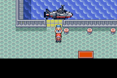

# Porto de Sootopolis

O terminal ocupa a água junto à margem oeste do lago. A ponte de madeira chega
à terra e foi prolongada exatamente um tile para a esquerda. O fundo verde do
telhado foi substituído pelo azul-claro do lago. A arquitetura usa o terminal
nativo de Slateport, com telhado azul.


O capitão atende dentro do porto, junto ao submarino ampliado em 2×. O sprite
passou de 32×32 para 64×64, com colisão em todo o seu retângulo sobre a água.
A passarela de embarque permanece livre. Não há barqueiro ou submarino do
serviço mundial do lado de fora.

O destino estável `17` da rede geral passa a desembarcar no interior. Os menus
regionais e a exclusão do próprio porto continuam usando o mesmo identificador.
A chegada de um novo jogo em Sootopolis também aponta para o terminal, sem
criar uma segunda embarcação. Os dois layouts da cidade, normal e crise,
recebem a mesma ponte e o mesmo edifício, preservando o palco dos lendários.

## Quatro edições e testes

[As quatro ROMs](../mods/hoenn/versions/START-HERE.md), nas combinações Gen 1–4 /
Gen 1–9 e Normal / Hard, incluem o novo porto. Os arquivos de `roms/`, o manifesto,
os hashes e o ZIP acompanham a atualização. Use uma cópia do save ou um save novo.

Os [relatórios por edição](../mods/hoenn/sootopolis-harbor-validation/README.md)
registram testes reais no motor mGBA em cada uma das quatro ROMs:

- Caminhada da terra até a porta e retorno, sem Surf.
- Entrada e saída pelos warps do terminal.
- Submarino compilado em 64×64 e colisão inteiramente sobre água.
- Conversa com os capitães físicos e viagem Sootopolis → Slateport → Sootopolis,
  com menus, animação e desembarque em terra.
- Entrada e saída a pé também no layout da crise.



A posição inicial, a equipe e o estado inicial da história são fixtures.
As caminhadas, conversas, portas e viagens usam comandos do controle. Não houve
uma campanha completa nem validação integral da abertura de um novo jogo em
Sootopolis. A reprodução independente da camada gerou 21 arquivos idênticos e
a segunda aplicação foi idempotente. Os testes costeiros da publicação anterior
continuam vinculados aos seus hashes originais, preservados em `validation-baselines/pr81`;
não são apresentados como repetidos nas novas ROMs.

## Reprodução

Use o checkout existente em `/workspace/AiKalicaAiCrlBR`; as tarefas da nuvem já
são isoladas, sem necessidade de criar um worktree. Com o GCC ARM 14.2.1 e os
binutils preparados conforme `tools/unova/bootstrap.py`, instale também as
dependências nativas `libpng-dev`, `pkg-config` e `libmgba-dev`.

Na raiz do repositório, exporte o caminho do GCC/binutils locais, quando usados:

```sh
export PATH="$PWD/.local/arm-gcc/usr/bin:$PWD/.local/arm-binutils/usr/bin:$PATH"
python3 tools/hoenn/acquire_multiregion.py --source .local/sootopolis-src
python3 tools/hoenn/build_integration_candidate.py --source .local/sootopolis-src --jobs 4
```

O comando de aquisição é apenas para uma pasta inexistente. Nas próximas
compilações, reutilize a fonte preparada e execute somente o build. A nova
camada é aplicada após `navigated-sea-atlas`, com hashes de entrada e saída.

```sh
gcc -shared -fPIC -O2 tools/rom_hacks/mgba_bridge.c -o .local/mgba-bridge.so -lmgba
python3 tools/hoenn/validate_sootopolis_harbor.py --source .local/sootopolis-src --library .local/mgba-bridge.so --output .local/sootopolis-check
python3 tools/hoenn/render_sootopolis_harbor.py --source .local/sootopolis-src --output .local/sootopolis-images
python3 -m unittest discover -s tools/hoenn -p test_sootopolis_harbor.py -v
```

As imagens da prévia são composições dos tiles e atores permanentes da fonte
compilada. As imagens em `validation/` são capturas do emulador.
