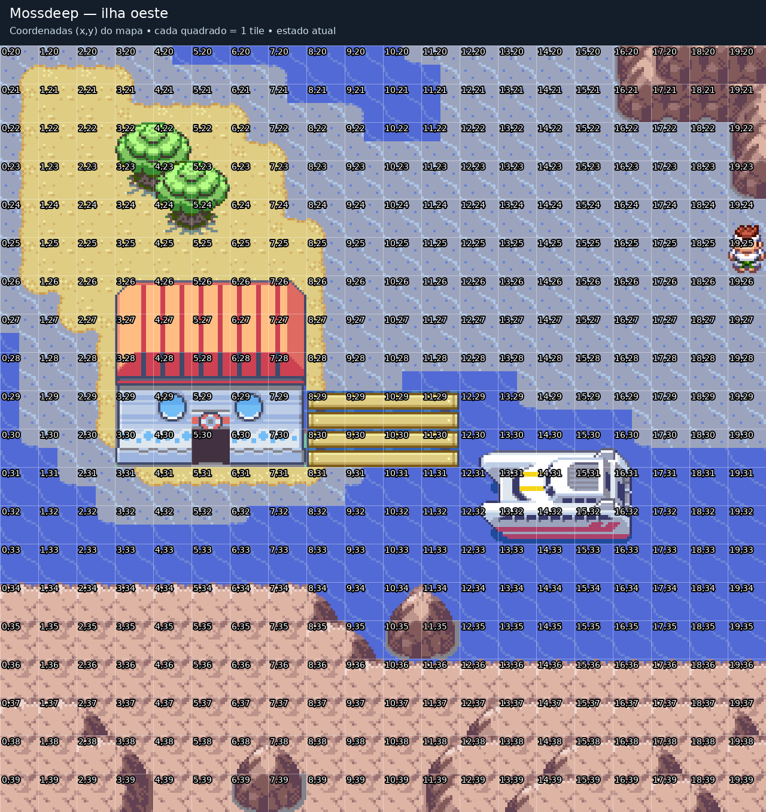
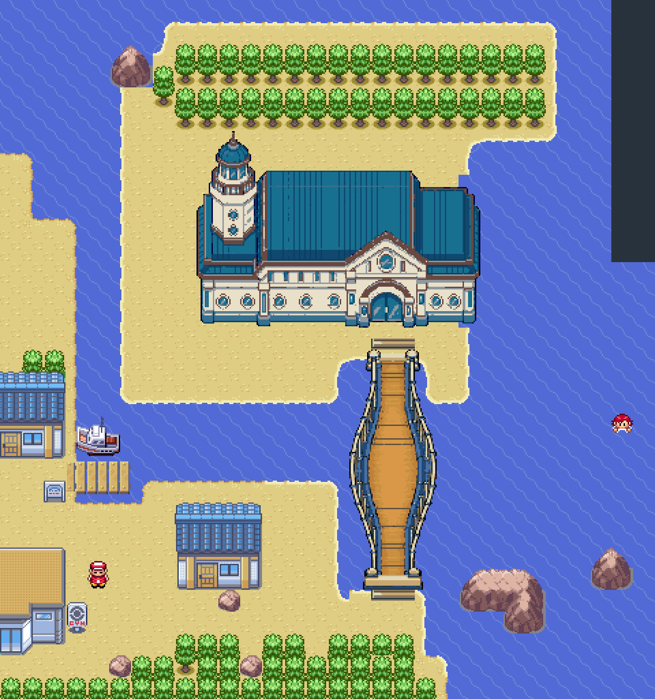
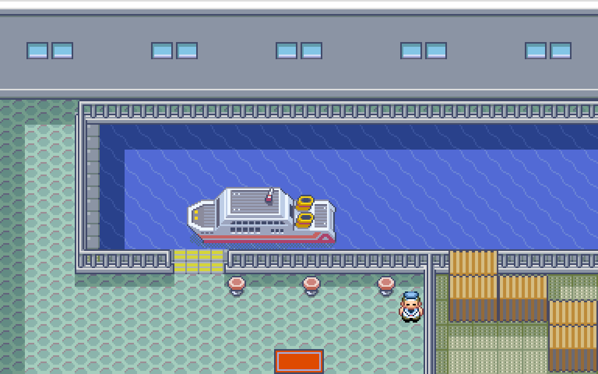

# Portos de Mossdeep e Dewford

Esta atualização inclui os dois portos nas quatro edições e preserva os terminais de Sevii do PR #89. As verificações são focadas nos portos e na travessia; a campanha inteira não foi jogada novamente.

## Mossdeep

O terminal ocupa `(3,26)..(7,30)` e a ponte horizontal ocupa `(8,29)..(11,30)`. A porta está em `(5,30)`. Os tiles `(3,32)` e `(6,32)` copiam respectivamente `(4,32)` e `(9,31)`.

## Dewford / Rota 107

Terminal original com telhado azul e torre náutica, construído com arte gerada e convertida em tiles GBA. A porta fica em `(5,2)` da Rota 107. O interior reutiliza o porto com navio S.S. Tidal e um capitão da rede mundial. Mr. Briney, seu barco e os treinadores nativos continuam nos locais originais.

A ponte é reta no trajeto, com piso contínuo e uma única base em cada extremidade. Sua representação tem o trecho central elevado. O piso ocupa as colunas `5..6`, linhas `4..14`; o Surf passa pelo nível inferior. Os cabos e os apoios laterais bloqueiam somente quem está no nível superior. O barco acrescentado sob a ponte foi retirado.

Os tiles `(4,10)`, `(5,10)` e `(5,11)` são água no nível inferior, sob a ponte preservada. As bordas retas e as curvas externas mantêm o contorno das peças inteiras de praia nativas, tomando como referência Rota 107 `(2,10)` e Dewford `(14,10)`. O acabamento tem uma faixa clara contínua de areia molhada, baseada na referência gerada abaixo. Os cantos internos são peças completas; o tile marcado em `(3,15)` une a praia ao acesso sul sem recortes soltos de quadrantes. A praia acompanha todo o contorno da areia exposta.

[Referência gerada para o acabamento da praia](images/island-harbors/Dewford-shore-reference.png). A imagem do porto mais abaixo é renderizada a partir dos tiles efetivos do jogo.

As árvores da fileira norte permanecem nas posições aprovadas; uma segunda fileira completa reforça a mata dentro da ilha, com a árvore em `(-5,-9)`, totalizando 35 unidades completas. As árvores na lateral direita foram retiradas para abrir o canal de saída do navio, ligado diretamente ao mar. A conferência das pedras encontrou 52 grupos nativos completos: 48 preservados e quatro retirados por inteiro onde o porto ou a ponte ocupam seu espaço. O rochedo grande a sudeste da ponte foi preservado.

As árvores de `(3,13)..(7,16)` foram retiradas por unidades completas; as copas junto à borda da clareira foram fechadas. O novo trecho ao norte está conectado à Rota 107 e à Rota 106 por conexões normais de mapa.

As escadas ocupam `(5,3)`, `(6,3)`, `(5,15)` e `(6,15)`. Os dois degraus de cada acesso têm 8 pixels de altura e usam os mesmos tons dos apoios da ponte, com os espelhos sombreados dos degraus nativos de GBA. As árvores entre a casa ao sul e a ponte foram retiradas por inteiro, deixando uma passagem a pé; a borda da mata restante começa com copas completas.

A praia contorna os dois acessos com bordas completas e curvas internas. O acesso norte tem um pequeno recuo de água sob a ponte; o acesso sul termina numa praia contínua dos dois lados dos degraus. A faixa de água junto ao lado oeste da ponte permanece aberta. Não há partes de fachada soltas no terreno. A ilha não foi ampliada. O lado direito do prédio fica diretamente sobre a água do canal; não há árvores cobrindo a fachada ou a passagem marítima. O acabamento marcado em `(3,15)` fecha a curva do acesso sul.

O terminal agora usa a resolução nativa de 208×144 pixels, preservando a definição dos detalhes do telhado e das janelas. A entrada continua no tile `(5,2)`.

[Imagem com coordenadas relativas à Rota 107](images/island-harbors/Dewford-island-harbor-grid.png).

A conferência usou caminhada no piso superior, Surf no inferior, entrada e saída pela porta, viagem para Pallet e retorno, e navegação pelas conexões ao norte. As primeiras posições e o estado inicial da história são fixtures. A reprodução independente confirmou as duas preparações e os 31.092 arquivos não alterados; a arte dos outros mapas que continuam usando a paleta nativa ficou idêntica. Battle Frontier preservada.

Evidências atuais: [controles e viagens nas cinco compilações](../mods/hoenn/island-harbors-validation/), [reprodução e cópias de tiles](../mods/hoenn/island-harbors-validation/source.json). Os resultados anteriores de Sevii e dos demais portos permanecem vinculados aos hashes das ROMs nas quais foram executados.

A inicialização no player web não foi conferida nesta revisão: o Chromium falhou ao criar threads no ambiente. A tentativa fora do sandbox foi cancelada. A evidência de navegador anterior não foi alterada nem apresentada como teste das ROMs atuais.
