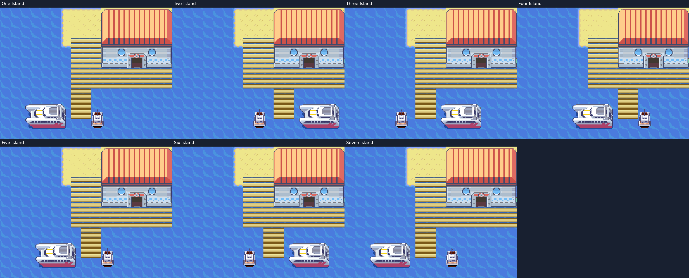

# Sete terminais de Sevii e navegação por Surf

One, Two, Three, Four, Five, Six e Seven Island recebem o terminal de
Pallet/Lavender: fachada de Slateport com fundo de areia, navio S.S. Tidal
permanente, colisão do casco e um único barqueiro interno. Os destinos estáveis
`2` a `8` da rede geral agora desembarcam dentro dos respectivos terminais.
Os barcos pequenos externos foram reposicionados; cada ilha ganhou também
um barco médio no lado oposto do píer. A saída dos antigos alojamentos é preservada.




## Passagens livres

O espaço antes ocupado pelo barco preso entre o cais e a areia foi fechado
com madeira. Cada píer ganhou uma extensão de três tiles para baixo, com
pranchas contínuas também no acesso de cima, sem bordas internas na junção.
Cada extensão tem duas colunas de largura. A posição da extensão e os lados das embarcações
variam nas sete ilhas. Uma faixa de água separa os cascos do cais superior.
Uma fileira completa de mar ao sul e duas colunas
a oeste ficam livres; as conexões exteriores e as dimensões dos mapas são
preservadas. As passarelas usam o comportamento nativo de ponte sobre água.
Os prédios ocupam o canto nordeste, sem fechar os acessos de Surf às cidades.

O cais de Cinnabar também permite Surf por baixo. Seu desenho, a porta e o
barco continuam nas posições aprovadas. Essa passagem mantém a saída sul
conectada ao oceano oeste e aos canais de Hoenn, além da circulação a pé
por cima da ponte.

| Ligação | Caminho atual |
|---|---|
| Sevii ↔ Kanto | One Island → mar costeiro de Kanto → acesso de Lavender → Lavender Port |
| Sevii ↔ Hoenn | One Island → mar ao norte de Sevii → canal leste de Kanto → North Hoenn Strait → Rota 124 |
| Two ↔ Three | Costa sul de Two Island → Two-Three Passage → costa oeste do porto de Three Island |
| Tanoby ↔ Birth | Tanoby Ruins → Tanoby Dawn Sea → Birth Island |

As sete costas nativas continuam alcançáveis por Surf. A inspeção do mapa
confere o cursor na posição real do personagem, incluindo abertura, retorno,
recentralização e zoom. O primeiro desembarque por Surf em One Island não
dispara a cena obrigatória da primeira chegada de ferry.

## Reprodução e testes

A camada `sevii-harbors` sucede `three-harbor-terminals`. No ambiente ARM
e mGBA já preparado:

```sh
python3 tools/hoenn/build_integration_candidate.py --source .local/sootopolis-src --jobs 4
python3 tools/hoenn/render_sevii_harbors.py --source .local/sootopolis-src --output docs/images/sevii-harbors
python3 tools/hoenn/validate_sevii_harbors.py --source .local/sootopolis-src --library .local/mgba-bridge.so --output mods/hoenn/sevii-harbors-validation/validation
python3 tools/hoenn/validate_sevii_surf_connections.py --source .local/sootopolis-src --library .local/mgba-bridge.so --output mods/hoenn/sevii-harbors-validation/validation
```

As quatro edições recebem testes próprios das sete portas, viagens a Pallet
e retorno, viagem a Hoenn, save/continue interno, saídas antigas e Surf pelas
sete costas. Também são percorridas viagens contínuas One Island ↔ Lavender Port e
One Island ↔ Rota 124 por Surf, sem teleporte durante os trajetos.
As posições iniciais e o estado inicial da história são fixtures;
os percursos e as escolhas de menu usam comandos do controle. Isso não
substitui uma campanha completa. As evidências dos demais portos conservam
os hashes das publicações em que foram executadas.
