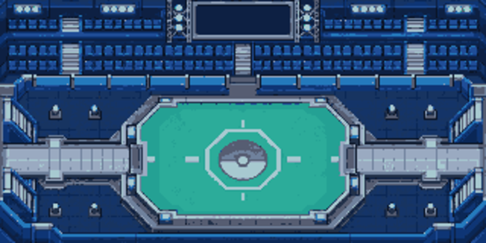
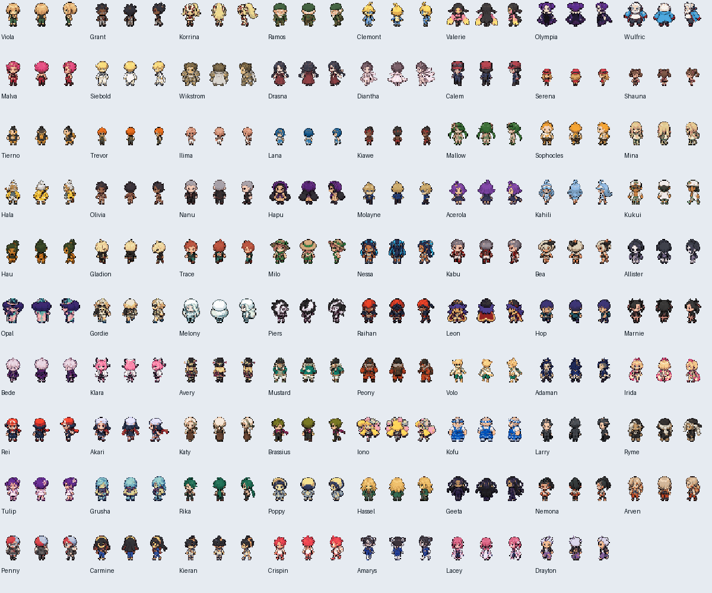

# PWT — torneios e arena

As quatro ROMs em `roms/` incluem esta implementação do PWT: torneios por geração, Copa global, 162 retratos de batalha, 162 identidades de caminhada e uma arena própria. Use um save novo conforme o guia das edições.

## Participantes e torneios

O catálogo atual contém 162 identidades: líderes, rivais, Elite Four, campeões e os convidados Eren, Luffy e Ash. Há um torneio por geração e uma Copa global. A edição até a geração 4 inclui 61 adversários e o jogador na Copa; a edição até a geração 9 inclui 162 adversários e o jogador. A cobertura atual vai até Scarlet/Violet com suas DLCs; a cobertura dos personagens de Legends Z-A ainda precisa de auditoria.

Os líderes que compartilham um ginásio, alternam conforme a versão ou sucedem outro líder têm inscrições independentes e equipes próprias no PWT:

| Região | Participantes separados |
| --- | --- |
| Kanto | Giovanni e Blue; Koga e Janine |
| Hoenn | Tate e Liza; Wallace e Juan |
| Unova | Cilan, Chili e Cress; Drayden e Iris |
| Galar | Bea e Allister; Gordie e Melony; Opal e Bede; Piers e Marnie |

Isso não separa as batalhas da campanha: Tate e Liza continuam lutando juntos no ginásio.

Singles com seis Pokémon, normalizados para o nível 50, mantendo as formas evoluídas treinadas antes da inscrição. A fase de grupos tem três a seis participantes por grupo para acomodar todo o catálogo. Todos enfrentam todos no próprio grupo: vitória vale três pontos, empate um e derrota zero. Os dois melhores classificam para o mata-mata. Os confrontos entre NPCs são simulados por força de equipe; as lutas do jogador acontecem no motor de batalha. Empates no mata-mata repetem a mesma partida.

O painel permite consultar todos os grupos e as páginas do chaveamento. SELECT alterna classificação/chaveamento; L/R mudam a página ou grupo; cima/baixo mudam a rodada do chaveamento; A/B continuam.

## Builds temporárias

As duas equipes recebem a otimização durante o PWT, incluindo nas edições Normal. Fora do PWT, continuam valendo as diferenças de IVs entre Normal e Hard.

- **Seu time:** os golpes, itens, habilidades, personalidade e identidade permanecem como você escolheu. Nature de batalha, EVs e IVs são ajustados nas cópias do torneio.
- **Adversários:** golpes competitivos legais para a espécie, com referência em Smogon; o gerador preserva as formas finais no nível 50.
- **EVs:** orçamento legal de 510, máximo de 252 por atributo. A seleção da distribuição considera os golpes efetivamente usados.
- **Ataque zero:** associado a Bold, Modest, Calm e Timid, as natures que reduzem Ataque, para reduzir o dano de confusão. Não é uma regra de Trick Room.
- **Velocidade zero:** para estratégias que favorecem Pokémon muito lentos em Trick Room e builds apropriadas de Gyro Ball. O time inteiro é analisado: o atacante pode se beneficiar de um companheiro com Trick Room sem aprender o golpe.
- **Atacantes mistos:** a nature não deve reduzir um dos atributos ofensivos usados pela build.

Há 1.252 spreads publicados congelados na referência `pkmn/smogon`, revisão `da97985286735d966ff09883ead0cbb7f10c77b5`. Os arquivos de sets dessa revisão coincidem com os da referência anterior. OU tem prioridade, seguido de National Dex e das análises individuais pertinentes. Muitas espécies básicas e algumas formas novas não têm análise OU publicada; para elas, a implementação adapta a distribuição à função do moveset. Essa adaptação não é apresentada como uma análise OU oficial nem como prova de uma distribuição matematicamente ótima.

Ao terminar, ser eliminado ou desistir, o jogo restaura o backup completo da equipe feita na inscrição: golpes e PP, HP, status, nível e experiência, EVs, IVs, nature, itens e habilidade. Hyper Training temporariamente desativado nas cópias não impede os IVs zero e também volta ao estado original ao sair.

## Evidência atual

O escopo de validação desta atualização é **PWT**, conforme solicitado. O manifesto identifica esse escopo; os testes históricos de campanha não são reapresentados como aprovação desta ROM.

Os [relatórios nativos](../mods/hoenn/pwt-world-validation/validation.json) identificam a SHA-256 exata de cada ROM de desenvolvimento. As quatro edições passaram pelas verificações de catálogo, geração de equipes, EVs, IVs, conservação dos golpes do jogador, navegação do painel e restauração byte a byte. Foram inspecionadas 446 equipes: 61 em cada edição Gen 1–4 e 162 em cada edição Gen 1–9.

A reconstrução independente chegou às 106 camadas e reproduziu os 1.366 arquivos preparados sem diferenças. Ela parte da reconstrução anterior que verificou os 30.038 arquivos upstream. A normalização determinística dos aliases de nomes de golpes não alterou nenhum byte da ROM validada.

Foram jogados torneios completos nas gerações 6 e 9, nas edições Gen 1–9 Normal e Hard, respectivamente. As vitórias são produzidas pelo motor de batalha, com retorno à recepção, premiação única de 10 BP e restauração da equipe. Viagem, criação da equipe e atributos de batalha elevados são fixtures declaradas para testar o fluxo; esse resultado não valida o equilíbrio competitivo nem uma campanha completa.

Casos específicos testados em todas as edições:

| Caso | HP / Atk / Def / SpA / SpD / Spe |
| --- | --- |
| Slowking como atacante de um time de Trick Room, sem aprender o golpe | 31 / 31 / 31 / 31 / 31 / 0 |
| Bronzong como atacante lento da mesma estratégia | 31 / 31 / 31 / 31 / 31 / 0 |
| Atacante especial com nature que reduz Ataque | 31 / 0 / 31 / 31 / 31 / 31 |
| Infernape misto | 31 / 31 / 31 / 31 / 31 / 31 |

Os 79 personagens modernos receberam nove quadros próprios de caminhada, convertidos para 32×32 pixels e 15 cores mais transparência. Os 83 conjuntos anteriores foram preservados. A validação nativa instancia todas as 162 identidades e verifica seus quadros compilados.

A arena usa uma arte própria adaptada à GBA: arquibancadas, telão, corredores laterais e palco central. Os participantes caminham por lados opostos antes de aparecer a classificação; a câmera acompanha o deslocamento real. O painel separado apresenta grupos e chaveamento. É uma adaptação ao estilo PWT de B2W2, sem afirmar uma reprodução pixel a pixel de toda a interface do Nintendo DS.

Continuam pendentes a auditoria dos times originais marcados como pendentes no catálogo e as campanhas completas de ponta a ponta. A fonte de 14 equipes de Sinnoh foi conferida nos dados originais de Platinum. Essas limitações não são contadas como testes aprovados.

## Fontes dos gráficos

As conversões são técnicas: encaixe com nearest-neighbor, paleta de 15 cores mais transparência e organização de frames. Os manifests guardam revisão, caminho, hash do blob Git e SHA-256 dos arquivos convertidos.

- Retratos: `josewp808/pokemon-trainer-sprites`, revisão `ba2d41a1ed3f49c00c74fe6c94a643860c45d5cd`.
- Adaman e Lacey: `christt105/pokemon-hof-generator`, revisão `e30aee2fab2b9d6d761e27f4fde29d33c2fef2e1`.
- Caminhada das primeiras gerações: catálogo de doadores de `jbfish00/Unbound-Character-Mode`, revisão `1dbb46d3e1609cadade70cf2efe246cc75d7f8e8`; preserva os autores citados por esse catálogo, incluindo pret, recursos de Sinnoh e o recurso de Gen 5 em estilo Gen 4.
- Eren, Luffy, Brendan e May: gráficos já integrados ao projeto.

- Caminhada moderna e arena: artes criadas com `image_gen`; folhas originais, referências de aparência, recortes, paletas e hashes preservados em `tools/hoenn/data/pwt/generated/`.
