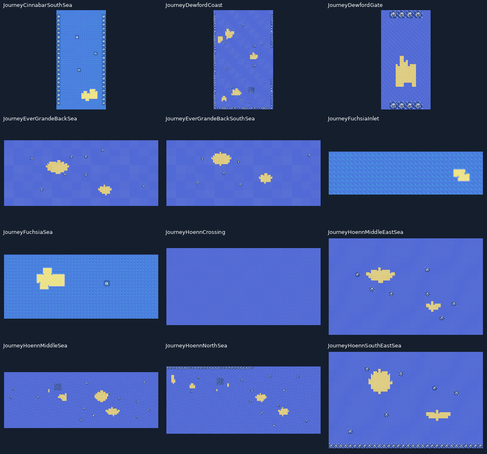
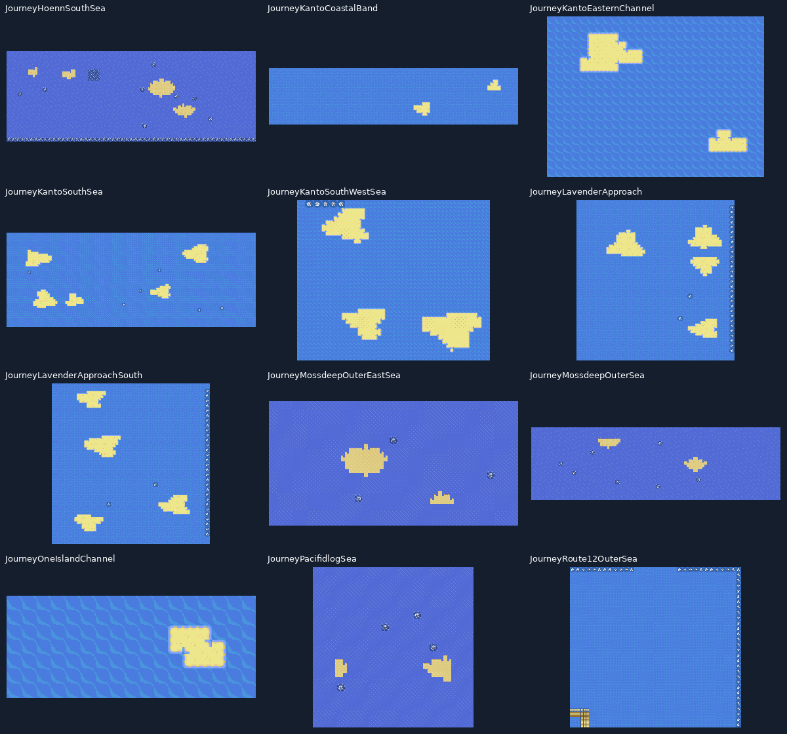
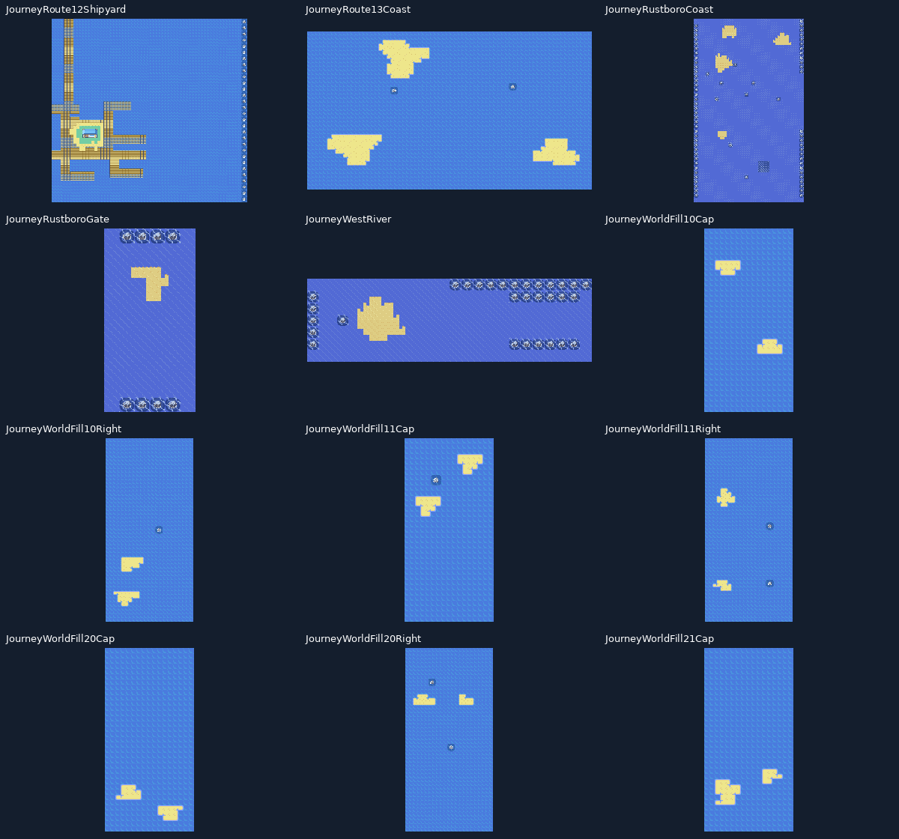
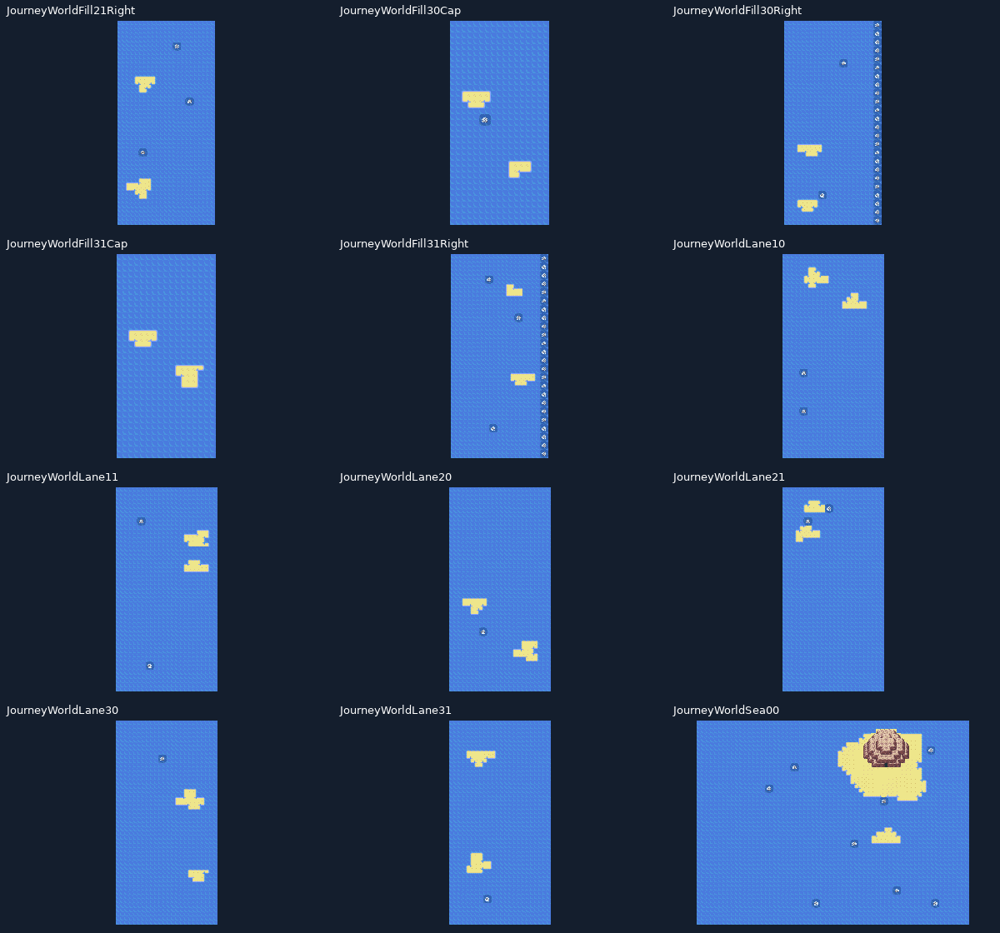
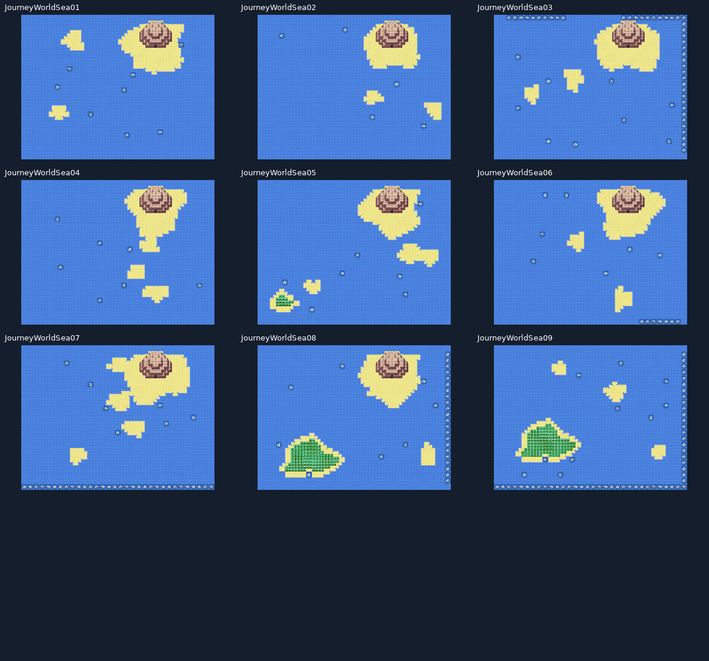
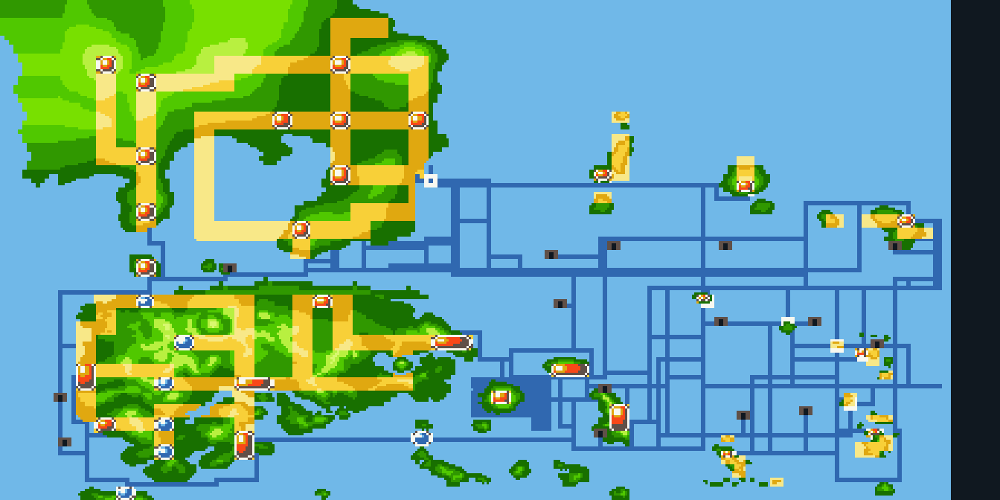

# Revisão visual das costas geradas

Composições dos arquivos de mapa e tiles da ROM. Atores e flags de história não são simulados nestas pranchas de terreno. A auditoria estrutural abrange 343 mapas editados; estas pranchas mostram as 57 áreas costeiras geradas. A galeria dos portos possui as estruturas e os atores permanentes.

## Mapa integrado

Diagrama esquemático das conexões marítimas reais, com linhas horizontais e verticais. Escalas locais variam; terra e cidades foram preservadas.

As ligações marítimas originais de Kanto e Hoenn também entram no desenho. Cavernas novas e Seafoam usam os acessos reais. O zoom tem detalhes próprios de 448×224 e conserva as âncoras geográficas.

