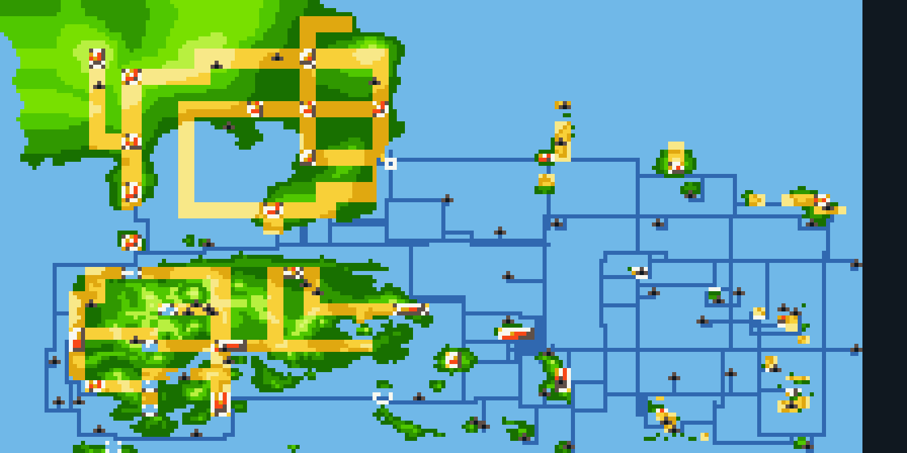
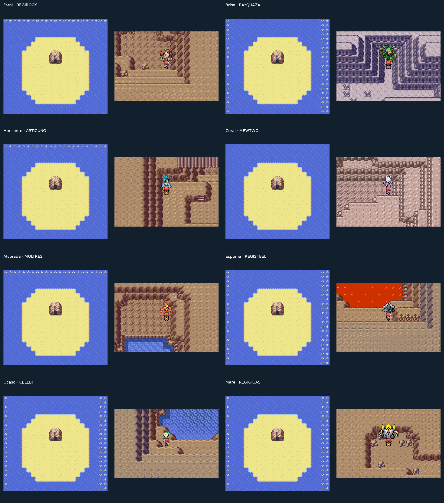

# Revisão de Surf e cavernas

Este guia registra a revisão de Surf do PR #92. Os acessos permanecem; os nomes e a distribuição atual dos encontros estão no [guia das 48 cavernas e câmaras](cavernas-lendarias.md).

A edição de inspeção está em [roms/rom-de-teste](../roms/rom-de-teste/LEIA-ME.md). As quatro edições normais recebem a mesma geografia e conservam encontros e abordagens automáticas.

As oito marcações amarelas receberam cavernas Farol, Brisa, Horizonte, Coral, Alvorada, Espuma, Ocaso e Maré. A marca vermelha recebeu um acesso por Surf à Artisan Cave existente, preservando seus dois acessos anteriores. Os traçados do atlas encontram a linha marítima existente mais próxima; as entradas são portas reais, com retorno, nos mapas do jogo. Coral ocupa uma ilha na rota existente, sem desvio para um mar distante.

O modelo externo das oito cavernas acompanha as demais cavernas das rotas de Surf. Cada sala interna tem uma planta diferente. Os oito lendários foram retirados, um por vez, da caverna então mais cheia. Os mesmos registros de captura impedem duplicação ou reaparecimento de um lendário já capturado.

Os limites usam pedras inteiras sobre água animada, incluindo mapas de largura ímpar. As laterais sem conexão possuem colisão; as ligações existentes continuam abertas. Os nomes são exibidos no aviso de entrada e na seleção do MAP, sem texto pintado sobre as linhas do atlas.

A ROM de teste desativa encontros aleatórios e a abordagem de treinadores por um registro compilado próprio, sem usar uma flag de save compartilhada com as edições normais. Interações deliberadas com treinadores e altares continuam disponíveis. O `.sav` incluído é um estado de inspeção preparado no emulador, com Surf disponível a partir de Mossdeep.

A validação desta entrega percorreu 235 conexões aquáticas nos dois sentidos, os 15 acessos anteriores e os nove acessos anotados. As nove viagens e as interações com os lendários transferidos foram repetidas nas quatro edições normais e na edição de teste. Foram conferidas as sete costas de Sevii, as cores das 16 emendas entre os bancos de Hoenn/Kanto, a exibição das pedras antes da troca de mapa e sua estabilidade durante a animação. [Travessia contínua Mossdeep–One Island](videos/mossdeep-one-island-surf.mp4). Os pontos iniciais, Pokémon da equipe, badges e Repel dos validadores são fixtures; os percursos, entradas, retornos e abertura do menu MAP usam controles reais no emulador. A campanha completa não foi repetida.
