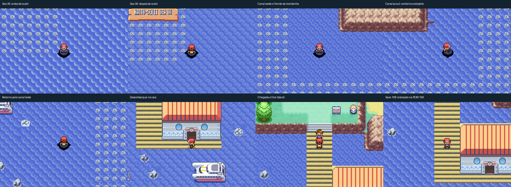

# Limites marítimos e acesso sul de One Island

O Sea 36 passa a mostrar o mesmo terreno nas duas câmeras dos cantos
reproduzidos. A correção consulta a arte do vizinho da diagonal sem liberar
colisão ou criar uma passagem fora das conexões reais. As laterais aquáticas
sem conexão recebem pedras nativas inteiras; a conferência de fonte cobre
284 mapas e preserva os vãos existentes.

Treasure Beach ganhou canais externos para contornar sua montanha por Surf.
Os 960 blocos originais e os eventos foram preservados em uma translação de
oito colunas. A montanha termina com frente e cantos completos. O percurso
nativo veio do Sea 36, contornou a praia, desembarcou no cais, chegou a One
Island e voltou: 392 tiles, dez transições, sem teletransporte no trajeto.
O desenho do mapa-múndi permanece igual; o GPS preserva os pixels antigos e
acompanha a nova área, com até dois pixels por passo e nenhum salto na emenda.

Saves antigos recebem a mesma translação uma única vez. Uma bateria 168 no
cais foi retomada na ROM 169, salva pelo menu e retomada novamente: a posição
passa de `(12,2)` para `(20,2)` e permanece ali na segunda retomada. Os testes
conferem o personagem visível, estado a pé e altura, além dos controles.

Os relatórios atuais ficam em
[`sevii-route-boundaries-validation`](../mods/hoenn/sevii-route-boundaries-validation/).
Há comparação compilada dos layouts, 46 renders inteiros com NPCs e provas
nativas dos dois cantos, oito barreiras, animação e saves. Renders de fonte
são identificados separadamente das capturas do emulador.

O censo também registra 107 células de cantos com candidatos contraditórios
em nove outros mapas. São candidatos de uma inspeção conservadora, que inclui
área fora da câmera jogável; exigem reprodução própria e não são certificados
por estas duas travessias. As provas históricas continuam ligadas às ROMs
anteriores. Esta revisão não representa quatro campanhas completas.

Reprodução, causa, prevenção e hashes:
[registro em TXT](../errors/2026-11-05-limites-e-acesso-one-island.txt).
