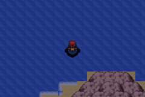

# Sevii conectada por Surf

As rotas marítimas existentes agora chegam às costas reais de One, Two, Three,
Four, Five, Six e Seven Island. A câmera acompanha a travessia entre os mapas.
É possível desembarcar na ilha, voltar a usar Surf e retornar ao mar do mundo.

O acesso usa a borda leste de cada área marítima de chegada e a costa oeste da
ilha correspondente. Em Three Island, a entrada chega ao mapa costeiro nativo
que segue para a cidade ao norte.

O evento da primeira chegada de barco em One Island não interrompe quem chega
por Surf. A posição no mapa-múndi acompanha as novas conexões, inclusive após
salvar e continuar.

Esta atualização parte de `e89729b` (main após os PRs #82 e #83). Não cria casas,
pontes, barcos ou barqueiros. Preserva as construções, os NPCs, os IDs de chegada
dos barcos e a terra nativa das ilhas, assim como os arquivos de Sootopolis e
Pallet dessa base.
O PR #84 de Pallet segue separado; suas alterações não fazem parte deste PR.

## Verificação

- Percurso contínuo com controle no mGBA: sete ilhas, desembarque e retorno,
  1.746 tiles, 14 travessias entre as áreas de chegada e as costas nativas.
- Nenhum fade nas 9.194 observações de frames próximas às novas travessias.
- Salvamento e Continue preservam localização e modo Surf.
- GPS compilado: 408.618 tiles, sem salto nas bordas conectadas e no máximo
  dois pixels por movimento de tile.
- Comparação de 31.006 arquivos de entrada que ficam fora da alteração.
- Reprodução independente dos 36 arquivos de saída das quatro camadas de Sevii.

O início do teste, a equipe no nível 100, as flags de treinadores derrotados e
Repel são fixtures. A navegação posterior usa os controles do emulador. Isso
não equivale a uma campanha inteira jogada novamente.

As capturas e os GIFs ficam em
[`mods/hoenn/sevii-surf-validation`](../mods/hoenn/sevii-surf-validation).

