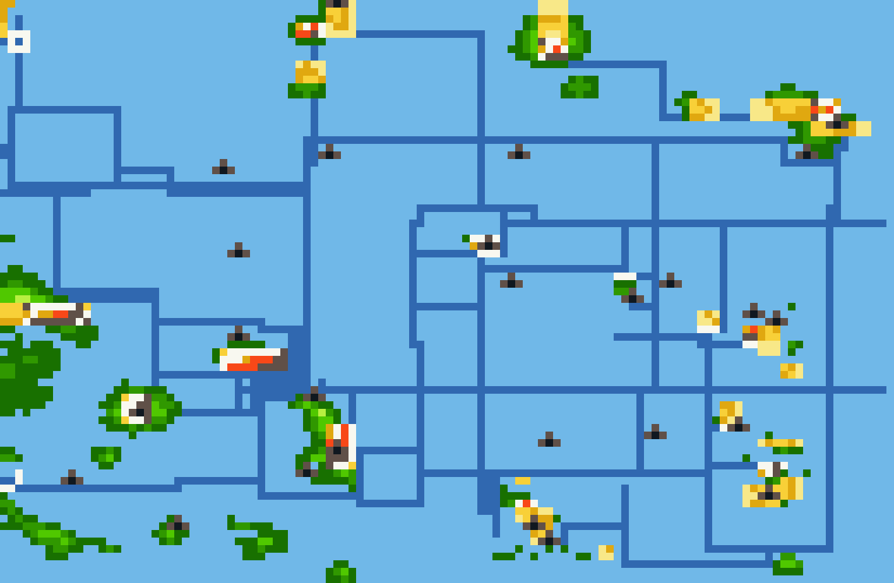

# Sevii conectada por Surf

As rotas marítimas existentes agora chegam às costas reais de One, Two, Three,
Four, Five, Six e Seven Island. A câmera acompanha a travessia entre os mapas.
É possível desembarcar na ilha, voltar a usar Surf e retornar ao mar do mundo.

O acesso usa a borda leste de cada área marítima de chegada e a costa oeste da
ilha correspondente. Em Three Island, a entrada chega ao mapa costeiro nativo
que segue para a cidade ao norte.

O evento da primeira chegada de barco em One Island não interrompe quem chega
por Surf. A posição no mapa-múndi acompanha as novas conexões, inclusive após
salvar e continuar.

A integração inclui o porto de Pallet já incorporado à `main`, com as novas
correções de acesso ao sul, do canto da borda e do corredor leste. Sootopolis
foi novamente testada. Os IDs de mapas e destinos anteriores são preservados.

## Atlas e passagens costeiras

O atlas usa linhas horizontais e verticais. Os trechos marcados em verde na
revisão foram unidos em linhas ou retângulos, com o mesmo traçado no zoom.
O desenho não tem nomes impressos: nomes e definições ficam na seleção do MAP
ou no [índice de rotas](rotas-maritimas.md).

Foram acrescentadas três passagens diretas que faltavam nas áreas vermelhas:

- **North Hoenn Strait:** canal de Kanto até a costa norte da Rota 124.
- **Two-Three Passage:** costa sul de Two Island até o mar de Three Island.
- **Tanoby Dawn Sea:** ligação de Tanoby e do mar de Seven Island até Birth Island.

As rotas são mapas jogáveis, com água de Surf, bordas fechadas onde não há
vizinho, bancos de areia e conexões recíprocas. Os novos IDs são acrescentados
ao fim do grupo existente. A terra, os eventos e as entradas nativas das ilhas
são mantidos. A antiga ligação Kanto Eastern Channel → Sea02 cede apenas sua
boca de quatro tiles para o novo canal; Sea01 ↔ Sea02 continua disponível.

Os três traçados costeiros são definidos explicitamente no atlas e no zoom,
para que o traçador automático não os substitua pelas linhas antigas. O GPS
das passagens fica preso às respectivas áreas geográficas; as coordenadas
dos mapas vizinhos são ajustadas sem saltos. A chegada de Two Island usa
agora a costa de Sevii, eliminando o antigo atalho de Surf para a Rota 12
de Kanto. As viagens de barco e seus destinos permanecem disponíveis.

## Verificação

As provas atuais incluem caminhada por controle nas sete costas de Sevii,
desembarque, retorno e Save/Continue; travessias de ida e volta nas três novas
passagens; e abertura do MAP em vários pontos percorridos de cada passagem.
O cursor deve mudar dentro da própria rota, coincidir com o tile atual,
manter a posição nas bordas e voltar ao jogador com SELECT, inclusive no zoom.
O GPS compilado é auditado em todas as conexões, sem salto entre as bordas
compartilhadas e com no máximo dois pixels por tile.

Pallet e Sootopolis têm novos testes de acesso e de viagem pela rede nas quatro
edições. Os hashes das provas nativas e das inicializações no navegador devem
corresponder às ROMs publicadas. A cadeia de 147 camadas é reproduzida a partir
das entradas verificadas; as provas históricas retêm os hashes de suas ROMs.

O início do teste, a equipe no nível 100, as flags de treinadores derrotados e
Repel são fixtures. A navegação posterior usa os controles do emulador. Isso
não equivale a uma campanha inteira jogada novamente.

As capturas e os GIFs ficam em
[`mods/hoenn/sevii-surf-validation`](../mods/hoenn/sevii-surf-validation).

