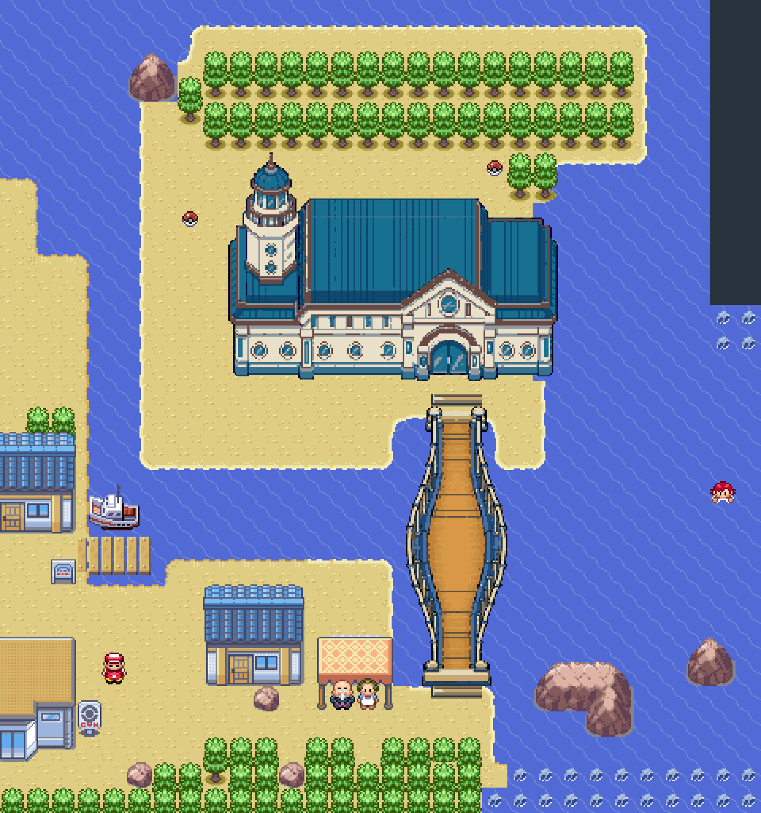
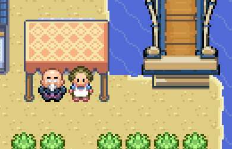
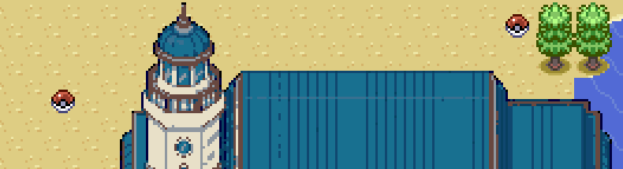

# Barraca de treinamento de Dewford

Uma barraca coberta do mercado de Slateport foi instalada entre a casa com pedra na frente e a ponte suspensa. São dois atendentes: o da direita vende equipamentos e o da esquerda faz Hyper Training. A passagem a pé pela frente permanece livre. Os tiles (3,13) e (3,14) usam a borda de praia de (3,12) sob a barraca.

O Bottle Cap comum melhora um atributo; o Gold Bottle Cap melhora os seis. O serviço exige nível 50, confirma antes de gastar e não altera os IVs herdados na reprodução. Atributos já perfeitos e Eggs não consomem tampinhas. Mints alteram o efeito da natureza nos atributos; Ability Capsule troca habilidades comuns e Ability Patch permite a habilidade oculta conforme as regras da espécie.

O Full Restore fica em uma Poké Ball à esquerda do porto. O TM55 Play Rough fica à esquerda das duas árvores novas atrás do prédio. O caminho por trás do topo do farol é transitável. Não foram retiradas Mega Stones nem outros itens, e nenhum outro porto foi modificado.

## Preços

A barraca vende 71 itens em cinco categorias, com os equipamentos de maior valor mais caros.

| Item | Preço |
|---|---:|
| Choice Band | 75.000 |
| Choice Specs | 100.000 |
| Choice Scarf | 100.000 |
| Flame Orb | 50.000 |
| Toxic Orb | 50.000 |
| Life Orb | 100.000 |
| Focus Sash | 100.000 |
| Eviolite | 100.000 |
| Rocky Helmet | 75.000 |
| Air Balloon | 50.000 |
| Red Card | 50.000 |
| Eject Button | 50.000 |
| Weakness Policy | 75.000 |
| Assault Vest | 100.000 |
| Safety Goggles | 75.000 |
| Terrain Extender | 50.000 |
| Protective Pads | 75.000 |
| Throat Spray | 75.000 |
| Eject Pack | 50.000 |
| Heavy Duty Boots | 100.000 |
| Blunder Policy | 50.000 |
| Room Service | 50.000 |
| Utility Umbrella | 50.000 |
| Clear Amulet | 100.000 |
| Covert Cloak | 100.000 |
| Loaded Dice | 100.000 |
| Booster Energy | 100.000 |
| Mirror Herb | 100.000 |
| Punching Glove | 75.000 |
| Ability Shield | 75.000 |
| Leftovers | 100.000 |
| Destiny Knot | 75.000 |
| Power Herb | 75.000 |
| Black Sludge | 75.000 |
| Ability Capsule | 250.000 |
| Ability Patch | 500.000 |
| Bottle Cap | 100.000 |
| Gold Bottle Cap | 500.000 |
| Lonely Mint | 100.000 |
| Adamant Mint | 100.000 |
| Naughty Mint | 100.000 |
| Brave Mint | 100.000 |
| Bold Mint | 100.000 |
| Impish Mint | 100.000 |
| Lax Mint | 100.000 |
| Relaxed Mint | 100.000 |
| Modest Mint | 100.000 |
| Mild Mint | 100.000 |
| Rash Mint | 100.000 |
| Quiet Mint | 100.000 |
| Calm Mint | 100.000 |
| Gentle Mint | 100.000 |
| Careful Mint | 100.000 |
| Sassy Mint | 100.000 |
| Timid Mint | 100.000 |
| Hasty Mint | 100.000 |
| Jolly Mint | 100.000 |
| Naive Mint | 100.000 |
| Serious Mint | 100.000 |
| Health Feather | 15.000 |
| Muscle Feather | 15.000 |
| Resist Feather | 15.000 |
| Genius Feather | 15.000 |
| Clever Feather | 15.000 |
| Swift Feather | 15.000 |
| Power Weight | 80.000 |
| Power Bracer | 80.000 |
| Power Belt | 80.000 |
| Power Lens | 80.000 |
| Power Band | 80.000 |
| Power Anklet | 80.000 |

## Itens Origin e missão Galactic

**Adamant Orb**, **Lustrous Orb** e **Griseous Orb** agora também revelam as formas Origin de Dialga, Palkia e Giratina ao equipar. Eles conservam seus aumentos de poder. **Adamant Crystal**, **Lustrous Globe** e **Griseous Core**, obtidos na missão Galactic, continuam ativando as mesmas formas. Retirar ou substituir o item por um incompatível restaura a forma normal. [Fotos e verificação dos menus](formas-origin.md).

A missão já existe no **Abandoned Ship**, com passagem além da cabine 6 no andar escondido, e exige as 16 insígnias e os seis encontros anteriores com cada um dos dois viajantes. É preciso enfrentar os grunts; Eren ajuda contra Mars e Charon, Luffy ajuda contra Saturn e Jupiter; depois vêm Cyrus e uma batalha contra Giratina sem captura nessa cena. A conclusão entrega Crystal, Globe e Core, com proteção para Bag cheia. Esta atualização preserva essa missão e não vende seus prêmios na barraca.

## Validação desta entrega

As evidências em `mods/hoenn/dewford-shop-validation/` registram compras reais por menu, consumo de dinheiro e tampinhas, Hyper Training, coleta dos dois itens e passagem atrás do farol nas quatro edições e na ROM de teste. Posições iniciais, dinheiro e Pokémon dos validadores são fixtures. As verificações anteriores de navegação permanecem vinculadas aos hashes originais; a campanha completa não foi repetida.
