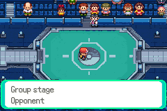
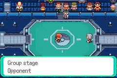

# Entrada dos adversários na arena do PWT

O jogador caminha até (9, 6). O adversário entra pela direita, em (17, 6), e dá quatro passos até (13, 6). Durante o anúncio da luta, os dois ficam visíveis frente a frente.

| Antes, o adversário estava fora do mapa | Depois, o adversário está na pista |
| --- | --- |
|  |  |

A função nativa de criação do personagem recebe coordenadas da grade do motor, que inclui sete casas de margem. A camada anterior passava coordenadas locais. O adversário começava em (10, −1) e terminava em (6, −1). Ao corrigir a conversão, foi preciso ajustar o momento da entrada. Enquanto o jogador ainda estava na extremidade esquerda, a câmera descarregava o adversário do lado direito. Agora o script aguarda a caminhada do jogador antes de chamar o adversário.

## Patches por edição

Aplique o BPS à edição correspondente da versão **Oito encontros antes do navio**. O player do projeto faz essa etapa automaticamente durante a preparação do site. [Versão de origem](../crossover-badges/README.md)

| Edição | BPS | Copa jogada | Vitórias na prova com equipe reforçada | Vitórias e derrotas na prova com atributos normais |
| --- | --- | --- | ---: | --- |
| Gen 1–4 Normal | [Baixar](Pokemon-Journey-Gen1-4-Normal.bps) | Geração 1 | 7 | 4 V, 2 D |
| Gen 1–4 Hard | [Baixar](Pokemon-Journey-Gen1-4-Hard.bps) | Geração 4 | 6 | 3 V, 2 D |
| Gen 1–9 Normal | [Baixar](Pokemon-Journey-Gen1-9-Normal.bps) | Geração 9 | 6 | 3 V, 2 D |
| Gen 1–9 Hard | [Baixar](Pokemon-Journey-Gen1-9-Hard.bps) | Mundial | 10 | 1 V, 3 D |
| TESTE | [Baixar](Pokemon-Journey-TESTE.bps) | Geração 3 | 8 | 5 V, 2 D |

O mGBA registrou a posição e a identidade do adversário antes de cada uma das 37 vitórias das copas com reforço. A premiação foi de 10 BP por título de geração e 25 BP pelo Mundial. Nas cinco participações com atributos normais, o controle automático perdeu a disputa, recebeu zero BP e recuperou a equipe original. A inscrição, a viagem e a equipe inicial foram preparadas para esses testes.

Cada pasta de edição contém capturas da apresentação e do convite para lutar, a bateria salva e os relatórios de torneio e combate em JSON comprimido. O comando abaixo reaplica os patches e confere os arquivos de evidência. [Manifesto das edições](validation.json)

```sh
python3 tools/hoenn/verify_pwt_arena_positions.py
```
