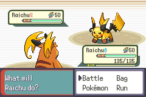

# Galar e Megas de Legends Z-A no PWT

O elenco do torneio tem 162 treinadores. A revisão usa as equipes das 13 revanches do Champion Cup de Sword e Shield. Cada equipe mantém os cinco Pokémon registrados e ganha uma sexta escolha coerente com o treinador. Por exemplo, Leon recebe o Haxorus que já usa na batalha de campeão, e Milo ganha o Ludicolo de outra variante da revanche. [Equipes e referências](../../../tools/hoenn/data/pwt-galar-party-review.json)

## Como as Megas funcionam

O mercado de Ever Grande já oferece as 45 pedras de Z-A e do DLC Mega Dimension. Para usar uma Mega no PWT, equipe a pedra compatível e acione **Start** na escolha do golpe com o Mega Ring na bolsa. O limite de espécies permite **17 formas na Gen 1–4** e **49 na Gen 1–9**. Formas especiais seguem seus requisitos de transformação, como Zygarde Completo.

O adversário mantém uma Mega Stone compatível escolhida pelo seu perfil competitivo. Quando a equipe precisa de uma pedra, a preparação procura do último Pokémon para o primeiro e entrega uma pedra de Z-A ao primeiro Pokémon compatível encontrado. A IA decide quando ativar a Mega Evolução durante a batalha.

## ROM de avaliação

Cada patch registra as duas primeiras etapas da revisão do PWT. Aplique-o à edição correspondente gerada pelos patches dos cortes **H, J e K**. [Patches do Atlas](../atlas-route-pruning/README.md)

| Edição | Patch |
| --- | --- |
| Gen 1–4 Normal | [BPS](Pokemon-Journey-Gen1-4-Normal-pwt-galar-za.bps) |
| Gen 1–4 Hard | [BPS](Pokemon-Journey-Gen1-4-Hard-pwt-galar-za.bps) |
| Gen 1–9 Normal | [BPS](Pokemon-Journey-Gen1-9-Normal-pwt-galar-za.bps) |
| Gen 1–9 Hard | [BPS](Pokemon-Journey-Gen1-9-Hard-pwt-galar-za.bps) |

## Reprodução e testes

Em uma cópia privada da fonte compilável com `pwt-official-parties`, aplique `tools/hoenn/prepare_pwt_galar_za_megas.py`, compile e empacote com `package_versions.py`. O validador de equipes compara os 446 times preparados nas quatro edições. O validador de Megas lê o estoque e os vínculos compilados, inicia uma partida do PWT e verifica Raichu Mega Y do jogador e Raichu Mega X de Lt. Surge. Os controles ativam a Mega do jogador, e a IA ativa a de Lt. Surge.

Os percursos de Kanto na Gen 1–4 Normal e de Galar na Gen 1–9 Hard terminaram com 10 BP e restauração da equipe. A preparação desses dois testes reforça os atributos do jogador para conferir todas as fases do torneio.

No teste sem reforço de Galar Hard, a equipe venceu Nessa e perdeu para Luffy e Kabu. O jogo voltou ao saguão e restaurou a equipe. Em batalhas fora do PWT, Garchomp Mega Z e Mega Greninja também voltaram à forma base ao fim.

`python3 tools/hoenn/verify_pwt_galar_za_megas.py` reconstrói as quatro ROMs e confere os hashes dos relatórios e das capturas. [Manifesto de validação](validation.json)

As 73 equipes seguintes estão no [catálogo completo do PWT](../pwt-complete-rosters/README.md).
